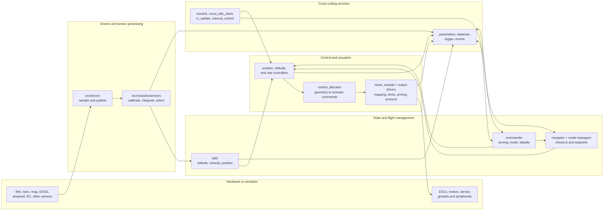

<p align="center">
  
</p>

# PX4 Firmware Architecture Analysis

> A source-based guide to the architecture of [PX4-Autopilot](https://github.com/PX4/PX4-Autopilot): its modules, uORB middleware, drivers, estimators, controllers, flight management, communications, build system, and simulation environment.

This repository explains how PX4 is organized, how data moves through it, which components own each decision, and where a contributor should make a change. It is written for programmers who want a useful mental model before reading or modifying the firmware.

**Analyzed source:** [`PX4/PX4-Autopilot@e58250d5b5`](https://github.com/PX4/PX4-Autopilot/tree/e58250d5b5d9afbe297cb2a082463d3caa417e53), full commit `e58250d5b5d9afbe297cb2a082463d3caa417e53` (`git describe`: `v1.18.0-beta1-1365-ge58250d5b5`). All source paths in these documents are relative to `PX4-Autopilot/` and all line references refer to that pinned revision. PX4 changes quickly, so re-check references when using another revision.

> [!IMPORTANT]
> This is an architecture guide, not flight-operating instructions. Do not test an unfamiliar control, arming, or output change on a vehicle with propellers attached.

## Documentation map

| # | Document | What it explains |
|---:|---|---|
| 00 | [Glossary](docs/00-glossary.md) | Acronyms, PX4 terms, message and naming conventions |
| 01 | [Architecture Overview](docs/01-architecture-overview.md) | Layers, source map, module boundaries, core design patterns |
| 02 | [Build System and Configuration](docs/02-build-system-and-configuration.md) | Make, CMake, Kconfig, board variants, generated code, firmware artifacts |
| 03 | [Boot and Startup](docs/03-boot-and-startup.md) | NuttX and POSIX startup, ROMFS scripts, airframes, module entry points |
| 04 | [uORB and Module Runtime](docs/04-uorb-and-module-runtime.md) | Pub/sub semantics, work queues, HRT, tasks, callbacks, timing |
| 05 | [Drivers and Platform Abstraction](docs/05-drivers-and-platform-abstraction.md) | Boards, buses, chip drivers, NuttX/POSIX/QURT, IMU and DShot examples |
| 06 | [Sensors and State Estimation](docs/06-sensors-and-state-estimation.md) | Calibration, selection, IMU integration, EKF2, multi-EKF, output prediction |
| 07 | [Flight Control Pipeline](docs/07-flight-control-pipeline.md) | Setpoint cascades, Control Allocation, output functions, MC/FW/VTOL/rover |
| 08 | [Commander, Modes, and Failsafes](docs/08-commander-modes-and-failsafes.md) | Arming, mode intention, health checks, control flags, failsafe actions |
| 09 | [Missions, Navigation, and Autonomy](docs/09-missions-navigation-and-autonomy.md) | Navigator, missions, RTL, geofence, Dataman, setpoint triplets |
| 10 | [Communication and ROS 2](docs/10-communication-and-ros2.md) | MAVLink, uXRCE-DDS, Zenoh, RC input, commands, telemetry, events |
| 11 | [Parameters, Storage, and Logging](docs/11-parameters-storage-and-logging.md) | Parameter layers, persistence, autosave, ULog, storage ownership |
| 12 | [Simulation, Testing, and Replay](docs/12-simulation-testing-and-replay.md) | Gazebo, MAVLink SITL, SIH, HITL, lockstep, tests, replay |
| 13 | [Contributor Guide](docs/13-contributor-guide.md) | Where to change code, common recipes, reviews, debugging checklists |

New readers should start with **01**, **04**, **06**, and **07**. Use **00** whenever a name is unfamiliar.

## Tech stack

- **Languages:** C++17 and C11 for firmware; Python for generators, tooling, and test runners; shell scripts for startup (`CMakeLists.txt:329-332`).
- **Concurrency:** NuttX tasks or POSIX threads, plus shared PX4 work queues. This is a modular, concurrent system—not one cooperative vehicle loop.
- **Internal integration:** uORB publish/subscribe messages generated from `msg/*.msg` and `msg/versioned/*.msg`.
- **Timing:** the High-Resolution Timer (HRT), event-driven uORB callbacks, and scheduled work items. POSIX SITL can use simulated lockstep time.
- **Platforms:** NuttX on microcontrollers, POSIX on Linux/macOS and SITL, QURT on supported Qualcomm targets, and a ROS 2 platform target.
- **Vehicle types:** multicopters, fixed-wing aircraft, VTOLs, rovers, and several experimental vehicle classes.
- **Estimation:** EKF2 with delayed measurement fusion and a current-time output predictor; optional multi-EKF selection.
- **External protocols:** MAVLink, uXRCE-DDS and Zenoh for ROS 2, DroneCAN/UAVCAN and Cyphal where configured, plus many RC and sensor protocols.
- **Build:** a Make front end, CMake, PX4 Kconfig, and a separate NuttX Kconfig layer.
- **Verification:** GoogleTest unit/functional tests, SITL tests, MAVSDK and ROS 2 integration tests, fuzz tests, sanitizers, and log replay.

## Approximate source statistics

These counts describe the pinned checkout and include generated-support code, vendored code, and legacy definitions where noted. They are orientation aids, not measurements of algorithm complexity.

- `src/`: about **822,000 lines** across roughly **3,480** C/C++/header/build/Python files.
- `platforms/`: about **128,000 lines** across roughly **770** corresponding files.
- `src/modules/`: **61** top-level module directories.
- `src/drivers/`: **76** top-level driver directories.
- `src/lib/`: **72** top-level reusable-library directories.
- `msg/`: **297** `.msg` files, including versioned and legacy message definitions.
- `boards/`: **49** vendor directories and **317** `.px4board` build configurations.

## The system at a glance

PX4 is best understood as a set of small applications that exchange typed messages. Hardware drivers publish measurements. Sensor processors and estimators turn them into vehicle state. Commander and Navigator decide what the vehicle should do. Controllers turn that intent into actuator commands. Output drivers apply safety limits and write hardware.



The arrows are mostly **uORB topics**, not direct function calls. This boundary is what allows a simulator to replace hardware drivers, a new estimator to feed existing controllers, or an external companion computer to supply setpoints.

## Five ideas that explain most of the code

1. **Modules are applications, not one object graph.** Each module has a command entry point and owns a clear responsibility. Build inclusion and runtime startup are separate decisions.
2. **uORB carries state and events.** A topic describes one kind of data. Multiple sensors of the same kind use topic instances. Publication copies data; it does not transfer ownership.
3. **Messaging and scheduling are separate.** A uORB callback or HRT deadline usually only schedules a `WorkItem`. The module runs later on its assigned work queue.
4. **Control is a cascade of contracts.** Navigator produces navigation setpoints; controllers reduce them to trajectory, attitude, rate, torque, and thrust setpoints; Control Allocation maps torque/thrust to actuators; output drivers handle physical channels and safety.
5. **Authority is explicit.** Commander decides arming, effective mode, and failsafe action. Navigator does not arm the vehicle. Controllers do not decide whether a mode is legal. Output modules still enforce disarmed/kill state after Control Allocation.

## Repository layout

```text
PX4-Autopilot/
├── Makefile                  # User-facing build targets; drives CMake
├── CMakeLists.txt            # Top-level build orchestration
├── Kconfig                   # PX4 feature and module configuration
├── boards/                   # Board configurations, startup, pins, buses, timers
├── cmake/                    # Build functions, Kconfig integration, metadata
├── msg/                      # uORB message schemas and generation rules
├── ROMFS/                    # Startup scripts, airframes, defaults embedded at build
├── platforms/
│   ├── common/               # uORB, work queues, ModuleBase, shared platform code
│   ├── nuttx/                # MCU/RTOS integration and SoC backends
│   ├── posix/                # Linux/macOS/SITL process and thread integration
│   ├── qurt/                 # Qualcomm Hexagon/SLPI integration
│   └── ros2/                 # ROS 2 platform target
├── src/
│   ├── drivers/              # Hardware drivers and driver entry points
│   ├── modules/              # Flight stack applications and services
│   ├── lib/                  # Reusable algorithms and infrastructure
│   ├── systemcmds/           # Shell commands: param, perf, reboot, ...
│   ├── examples/             # Small example modules
│   ├── include/              # Shared headers and containers
│   └── templates/            # Starting points for new modules
├── test/                     # MAVSDK, ROS 2, fuzz and runner-level tests
├── Tools/                    # Code generators, setup, simulation and CI tooling
├── validation/               # Additional validation assets
└── docs/                     # Upstream PX4 user/developer documentation
```

The `docs/` directory in **this architecture repository** is separate from `PX4-Autopilot/docs/`; the upstream source tree is not modified.

## Find the right place for a change

| I want to... | Start here | Detailed guide |
|---|---|---|
| Add a module | `src/templates/template_module/`, `src/examples/work_item/`, `src/modules/Kconfig` | [02](docs/02-build-system-and-configuration.md), [13](docs/13-contributor-guide.md) |
| Add or change a topic | `msg/`, `msg/CMakeLists.txt`, `Tools/msg/` | [04](docs/04-uorb-and-module-runtime.md) |
| Add a board | `boards/<vendor>/<model>/` and its `nuttx-config/` | [05](docs/05-drivers-and-platform-abstraction.md) |
| Add an I2C/SPI sensor | `src/drivers/`, `src/lib/drivers/device/`, board `rc.board_sensors` | [05](docs/05-drivers-and-platform-abstraction.md) |
| Change estimation | `src/modules/ekf2/`, `src/modules/sensors/` | [06](docs/06-sensors-and-state-estimation.md) |
| Change multicopter control | `mc_pos_control`, `mc_att_control`, `mc_rate_control` | [07](docs/07-flight-control-pipeline.md) |
| Change actuator geometry or limits | `control_allocator`, `src/lib/control_allocation/`, `mixer_module` | [07](docs/07-flight-control-pipeline.md) |
| Change arming or failsafe behavior | `src/modules/commander/` | [08](docs/08-commander-modes-and-failsafes.md) |
| Change missions or Return behavior | `src/modules/navigator/` | [09](docs/09-missions-navigation-and-autonomy.md) |
| Add a MAVLink stream | `src/modules/mavlink/streams/`, `mavlink_messages.cpp` | [10](docs/10-communication-and-ros2.md) |
| Expose a ROS 2 topic | uXRCE: `src/modules/uxrce_dds_client/dds_topics.yaml`; Zenoh: `src/modules/zenoh/dds_topics.yaml` and runtime CSV mappings | [10](docs/10-communication-and-ros2.md), [13](docs/13-contributor-guide.md) |
| Add a parameter | The owning module's YAML and `ModuleParams` declaration | [11](docs/11-parameters-storage-and-logging.md) |
| Add a logged topic | `src/modules/logger/logged_topics.cpp` or a logger profile | [11](docs/11-parameters-storage-and-logging.md) |
| Add a simulation model or test | `ROMFS/.../airframes/`, `src/modules/simulation/`, `test/` | [12](docs/12-simulation-testing-and-replay.md) |

## Reading conventions

- `path/to/file.cpp:120-145` means a source range in the pinned PX4 revision.
- `vehicle_attitude` is a **uORB topic**; `vehicle_attitude_s` is its generated C struct; `px4::msg::VehicleAttitude` is its C++ message alias where used.
- `Module` means a PX4 application/driver registered with `px4_add_module()`, not necessarily a C++ class or an OS process.
- Diagrams emphasize ownership and data flow. They omit many optional modules so the main architecture remains readable.
- Simple descriptions come first; implementation notes and pitfalls follow for contributors.
