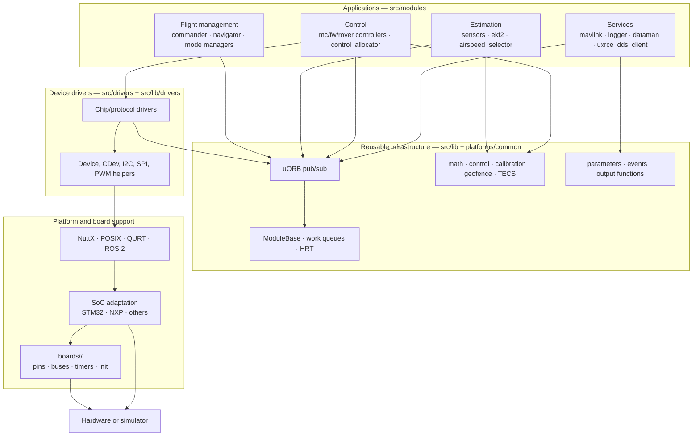
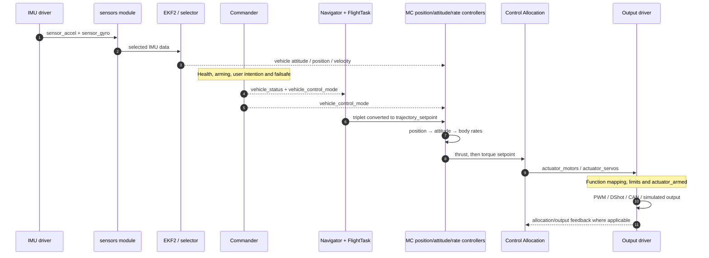

# 01 · Architecture Overview

> Source: [`PX4-Autopilot@e58250d5b5`](https://github.com/PX4/PX4-Autopilot/tree/e58250d5b5d9afbe297cb2a082463d3caa417e53). Paths below are relative to that tree.

**Previous: [00 · Glossary](00-glossary.md)** · **[Index](../README.md)** · Next: [02 · Build System and Configuration](02-build-system-and-configuration.md)

---

PX4 is a **modular, message-driven autopilot**. It is not one large vehicle class and not one main loop. Independent drivers, estimators, controllers, services, and output modules run concurrently and communicate through typed uORB topics.

The main architectural layers are:

1. **Platform and board support** — operating system, clocks, buses, pins, timers, and board initialization.
2. **Drivers** — convert hardware or simulator input into standard messages and convert output messages into hardware signals.
3. **Middleware and reusable libraries** — uORB, work queues, parameters, math, calibration, control, and persistence helpers.
4. **State estimation** — sensor processing, selection, EKF2, and vehicle-state topics.
5. **Flight management** — Commander, Navigator, flight-mode managers, health checks, and failsafes.
6. **Control and actuation** — cascaded controllers, Control Allocation, output functions, and output safety.
7. **External services** — MAVLink, ROS 2/DDS, logging, events, shell commands, and simulation bridges.



## 1. Source tree by responsibility

### `src/modules/`: applications and services

A module usually has its own command (`commander start`, `ekf2 start`, and so on), lifecycle, configuration, and topic interface. Important groups include:

| Directory | Responsibility |
|---|---|
| `sensors/` | IMU integration, calibration use, sensor selection, air data, GNSS, magnetometer, optical flow |
| `ekf2/` | EKF input buffering, delayed fusion, output prediction, multi-instance selection, estimator outputs |
| `commander/` | Arming, operating state, health checks, mode intention, external modes, failsafes |
| `navigator/` | Mission, Takeoff, Land, Loiter, Return, geofence, navigation setpoint triplets |
| `flight_mode_manager/` | Multicopter FlightTasks and local trajectory generation |
| `fw_mode_manager/` | Fixed-wing mode and setpoint selection |
| `mc_pos_control/`, `mc_att_control/`, `mc_rate_control/` | Multicopter position, attitude, and rate loops |
| `fw_lateral_longitudinal_control/`, `fw_att_control/`, `fw_rate_control/` | Fixed-wing guidance/control cascade |
| `vtol_att_control/` | VTOL transition state and virtual MC/FW setpoint routing |
| `control_allocator/` | Vehicle geometry and torque/thrust-to-actuator allocation |
| `rover_ackermann/`, `rover_differential/`, `rover_mecanum/` | Rover-specific control and direct normalized actuator commands |
| `manual_control/`, `rc_update/` | RC/manual source processing and selection |
| `mavlink/`, `uxrce_dds_client/`, `zenoh/` | External protocol bridges |
| `logger/`, `dataman/`, `events/` | Logging, indexed persistence, structured events |
| `land_detector/`, `battery_status/`, `airspeed_selector/` | Specialized state and health producers |
| `simulation/` | Simulator bridges, sensor simulators, SIH, simulated outputs |

### `src/drivers/`: hardware-facing modules

Drivers know chip registers, wire protocols, and hardware timing. They should expose reusable messages rather than vehicle-specific behavior. The tree contains IMUs, barometers, magnetometers, GNSS, distance sensors, differential pressure, RC input, PWM/DShot, CAN, telemetry, lights, cameras, and many other peripherals.

A chip driver often has two halves:

- a **module entry point** that parses common bus options and starts instances;
- a **chip implementation** that probes, configures, reads, validates, and publishes data.

### `src/lib/`: reusable implementation, not top-level policy

Libraries contain math (`matrix`, `mathlib`), PID/rate control, Control Allocation algorithms, sensor calibration, output functions, geofence, TECS, mission clients, parameters, events, ULog support, and device abstractions. Good library code can be tested without owning the flight-mode decision or startup sequence.

### `platforms/`: common runtime and OS-specific implementations

| Directory | Role |
|---|---|
| `platforms/common/` | uORB, `ModuleBase`, work queues, parameters interface, shared bus enumeration, common includes |
| `platforms/nuttx/` | NuttX startup, built-in command registration, MCU/SoC adaptations, flat/protected builds |
| `platforms/posix/` | Host process, threads, POSIX HRT, lockstep, daemon/client command dispatch |
| `platforms/qurt/` | Qualcomm/SLPI platform implementation |
| `platforms/ros2/` | ROS 2 platform build and interface generation |

### `boards/`: board identity and composition

A board directory can contain:

- `default.px4board` and other feature variants;
- `nuttx-config/` with NuttX defconfigs, clocks, pins, and linker files;
- `src/board_config.h`, `init.cpp`, `spi.cpp`, `i2c.cpp`, `timer_config.cpp`;
- `src/CMakeLists.txt` for board-source build rules;
- `init/rc.board_*` startup hooks;
- bootloader configuration and firmware metadata.

Board data and chip drivers are deliberately separate: an IMU driver should not hardcode one board's SPI bus or chip-select pin.

### `msg/`: internal interface contracts

Each `.msg` file defines a payload. Optional `# TOPICS` lines create multiple topic names for the same payload, and `ORB_QUEUE_LENGTH` requests more than one retained sample. Generators produce C/C++ types, topic metadata, message hashes, JSON metadata, and uCDR serializers.

Adding only a `.msg` file is normally insufficient: the message must also be included in `msg/CMakeLists.txt` (`msg/CMakeLists.txt:39-325`).

### `ROMFS/`: executable configuration

ROMFS contains startup scripts, airframe scripts, defaults, and generated-script inputs. It answers questions such as:

- Which airframe is selected?
- Which board sensors should start?
- Which controllers belong to this vehicle type?
- Which communication and logging services should run?

A module can be compiled into firmware but never started. Kconfig controls **presence**; startup scripts control **execution**.

## 2. Module boundaries and dependency direction

The preferred dependency direction is:

```text
policy/application → reusable library → platform interface → OS/board implementation
```

For example:

```text
mc_rate_control
    → src/lib/rate_control
    → matrix/mathlib and uORB
    → work queue and HRT abstractions
    → NuttX or POSIX
```

The reverse direction would create tight coupling. A low-level IMU driver should not call Commander, and a math library should not decide the active flight mode.

Most cross-module runtime dependencies are **data dependencies**, not link-time calls:

| Producer | Message | Consumer |
|---|---|---|
| IMU driver | `sensor_gyro` | `VehicleIMU`, angular-velocity processing |
| `VehicleIMU` | `vehicle_imu` | EKF2 in multi mode; sensors selection |
| EKF2 / selector | `vehicle_attitude` | attitude controllers, Commander, telemetry |
| Commander | `vehicle_control_mode` | controllers and Control Allocation |
| Navigator | `position_setpoint_triplet` | vehicle mode managers / FlightTasks |
| Rate controller | `vehicle_torque_setpoint` | Control Allocation |
| Control Allocation | `actuator_motors` | output-function providers |
| Output module | `actuator_outputs` | logging, simulation, diagnostics |

This makes interfaces inspectable with `uorb top`, loggable with ULog, and replaceable in simulation.

## 3. The four planes of the architecture

It helps to separate four kinds of behavior that diagrams often mix together.

### 3.1 Measurement plane

```text
sensor hardware → driver topics → calibrated/integrated vehicle topics → EKF → state topics
```

Its purpose is to produce timely, consistent estimates of the vehicle and environment. See [06](06-sensors-and-state-estimation.md).

### 3.2 Decision plane

```text
user/offboard/health inputs → Commander → effective mode and control flags
                                      → Navigator → navigation setpoints
```

Its purpose is to decide what the vehicle is allowed and intended to do. See [08](08-commander-modes-and-failsafes.md) and [09](09-missions-navigation-and-autonomy.md).

### 3.3 Control plane

```text
navigation/manual/offboard setpoints → controllers → torque/thrust → allocation → outputs
```

Its purpose is to track setpoints while respecting vehicle dynamics and actuator limits. See [07](07-flight-control-pipeline.md).

### 3.4 Service plane

MAVLink, DDS, parameters, logging, Dataman, events, and shell commands observe or modify the other planes through defined interfaces. They should not create hidden second state machines.

## 4. Core design patterns

### 4.1 Typed publish/subscribe at subsystem seams

uORB provides a common data vocabulary. Publishers copy complete messages into a topic node. Subscribers have independent cursors and can use latest-value or queued semantics.

This is not a general RPC framework and not a transaction across topics. If a consumer needs two messages in a meaningful order, the producer and consumer must define that convention. For example, multicopter rate control publishes thrust before torque; torque schedules Control Allocation, which then reads the latest thrust (`src/modules/mc_rate_control/MulticopterRateControl.cpp:271-277`, `src/modules/control_allocator/ControlAllocator.cpp:382-405`).

### 4.2 Event-driven work with timer backup

Fast modules commonly run when an input topic updates:

```text
publisher → subscription callback → WorkItem::ScheduleNow() → queue worker → module Run()
```

A delayed schedule often acts as a watchdog or fallback. This avoids a polling-only architecture while still handling lost or stopped input. HRT callouts schedule work; they do not run the control loop directly in the timer interrupt.

### 4.3 Dedicated tasks for loops, work queues for scheduled modules

- A dedicated module implements lowercase `run()` and usually blocks on poll or sleeps.
- A work-queue module implements uppercase `Run()` and shares a worker with other modules.
- `ModuleBase` supplies command and lifecycle behavior to both (`platforms/common/include/px4_platform_common/module.h:67-177`).

All items on one work queue execute serially. Queue selection is therefore a real-time design decision, not just a configuration detail.

### 4.4 State ownership instead of shared global vehicle objects

There is no single mutable `Vehicle` object through which every subsystem reads and writes. Authority is distributed:

- Commander owns `vehicle_status` and effective control mode.
- EKF2/selector owns estimated vehicle-state topics.
- Navigator owns autonomous navigation state and triplets.
- Controllers own their respective setpoint outputs.
- Output modules enforce final physical-output safety.

Subscribers retain the last value they need, but the producer remains responsible for validity, timestamps, and reset/change counters.

### 4.5 Board data injected into reusable drivers

Board files describe bus number, chip select, data-ready pin, rotation, and timer/DMA mapping. Common driver framework code passes these as configuration to chip drivers. This lets one ICM42688P driver run on many boards without board-specific `#ifdef`s.

### 4.6 Generated contracts

Build-time generators produce:

- uORB types and topic metadata from `.msg` files;
- parameter declarations and metadata from module YAML and board configuration;
- airframe metadata and startup dispatch scripts;
- DDS serializers and topic bridge code;
- MAVLink and platform-specific command registration support.

Edit the source schema or template, not the generated file under `build/`.

## 5. End-to-end runtime example

This sequence shows the main multicopter autonomous path and the separation between decision, estimation, and control.



Important details hidden by the simplified arrows:

- The rate controller is normally gyro-driven, not mission-loop-driven.
- The EKF output predictor can publish attitude on every IMU input even when a delayed EKF correction does not complete on that iteration (`src/modules/ekf2/EKF2.cpp:853-918`).
- Commander publishes `actuator_armed` before control mode and status (`src/modules/commander/Commander.cpp:2166-2183`).
- Control Allocation does not bypass output arming and failsafe handling.

## 6. Real-time architecture without one fixed “main frequency”

Different paths run at different rates and are triggered by different events:

| Path | Typical trigger | Timing concern |
|---|---|---|
| IMU driver | DRDY interrupt or periodic fallback | Sample integrity, bus latency, no work in ISR |
| `VehicleIMU` | Gyro publication with backup schedule | Integration window and sample timestamps |
| Angular-velocity processing | Selected gyro/FIFO | Filtering and control latency |
| EKF2 | IMU input with delayed backup | Delayed fusion and current-time output |
| MC rate control | `vehicle_angular_velocity` | Highest-level control-rate freshness |
| Position/mode management | Local-position or scheduled updates | Outer-loop continuity and constraints |
| Commander | 10 ms loop in the analyzed revision | Health/failsafe latency, not motor-rate control |
| MAVLink | Receiver thread plus stream-scheduled main task | Link budget and transport capacity |
| Logger | Topic updates/timer and writer thread | Buffering and dropout reporting |

A statement such as “PX4 runs at 250 Hz” is therefore incomplete without naming the module and message path.

## 7. Coordinates, timestamps, and validity are part of the API

A message is more than an array of numbers. Contributors must preserve:

- **Frame:** body FRD, local NED, global WGS84, or another explicitly documented frame.
- **Units:** rad/s, m/s², meters, normalized commands, microseconds, natural output units, and so on.
- **Sample time versus publication time:** `timestamp_sample` describes the measurement; `timestamp` normally describes publication.
- **Validity:** explicit flags, timeouts, device IDs, and reset/calibration counters.
- **NaN semantics:** “not controlled,” “invalid,” or “stopped” depending on the exact schema.
- **Instance identity:** runtime instance number is not a permanent hardware identity; device IDs and calibration slots matter.

Ignoring these contracts can produce code that compiles and even flies in simple tests while failing during sensor switching, estimator resets, VTOL transitions, or actuator saturation.

## 8. Architecture rules for contributors

1. Keep one clear owner for each state machine and published topic.
2. Prefer a new message or library interface over a cross-module global variable.
3. Keep bus and OS details below portable module code.
4. Do not put substantial work in uORB callbacks, HRT callouts, or ISRs.
5. Preserve sample timestamps and define behavior for stale or invalid data.
6. Treat work-queue choice, queue depth, and fallback scheduling as part of the design.
7. Separate build inclusion, startup, arming permission, and controller enablement.
8. Use existing safety boundaries: Commander for mode/arming decisions and `MixingOutput` for final output safety.
9. Update `msg/CMakeLists.txt`, Kconfig, ROMFS, tests, and metadata when the change requires them; editing only the C++ file is often incomplete.
10. Verify behavior in logs and SITL, including failure paths—not only the happy path.

---

**Previous: [00 · Glossary](00-glossary.md)** · **[Index](../README.md)** · Next: [02 · Build System and Configuration](02-build-system-and-configuration.md)
