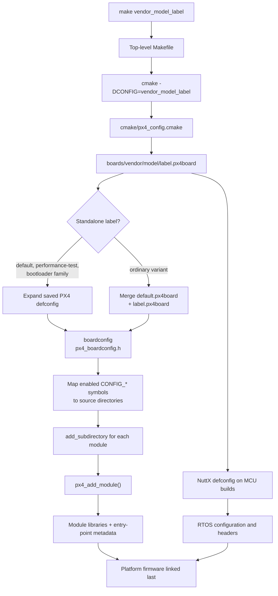
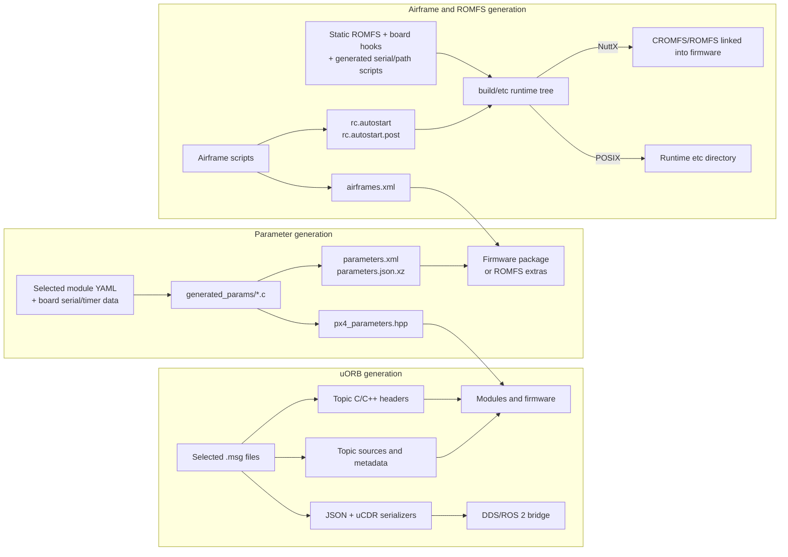

# 02 · Build System and Configuration

**Previous: [01 · Architecture Overview](01-architecture-overview.md)** · **[Index](../README.md)** · Next: [03 · Boot and Startup](03-boot-and-startup.md)

---

PX4's build turns a board name into a configured firmware image and a generated runtime file tree. The process involves four different kinds of configuration that contributors often confuse:

1. **Make targets** select a board configuration.
2. **PX4 Kconfig** selects PX4 modules, drivers, platform options, and ROMFS behavior.
3. **NuttX Kconfig** configures the RTOS and SoC peripherals on MCU builds.
4. **CMake build type** selects optimization/debug/sanitizer behavior.

These choices are related, but none replaces the others.

## 1. From `make` to a board build

The top-level `Makefile` discovers every `boards/<vendor>/<model>/<label>.px4board` file and exposes it as:

```text
<vendor>_<model>_<label>
```

For example:

```bash
make px4_fmu-v6x_default
make px4_fmu-v6x_default upload
make px4_sitl_default
```

The `_default` suffix can normally be omitted, so `make px4_sitl` selects `px4_sitl_default` (`Makefile:236-250`). Additional goals such as `upload` are forwarded to the generated build system.

Make's central recipe (`Makefile:179-214`):

1. passes `-DCONFIG=<vendor>_<model>_<label>` to CMake;
2. uses `build/<config>/` as the build directory;
3. configures CMake when the cache is absent or options changed;
4. invokes Ninja or generated Makefiles.



## 2. Board-name resolution

`cmake/px4_config.cmake:51-117` searches board files, splits the path into vendor/model/label, and sets variables including:

- `PX4_CONFIG_FILE`
- `PX4_BOARD_DIR`
- `VENDOR`, `MODEL`, `LABEL`
- `PX4_BOARD`
- `PX4_CONFIG`

The canonical full name is `<vendor>_<model>_<label>`. A historical `<vendor><model>_<label>` form is also accepted where implemented.

### Labels: standalone configuration or overlay?

The behavior is explicit in `cmake/kconfig.cmake:81-101`:

| Label | How it is configured |
|---|---|
| `default` | Standalone saved defconfig; suffix may be omitted in Make target |
| `performance-test` | Standalone saved defconfig |
| `bootloader` and labels beginning `bootloader` | Standalone bootloader build path |
| `canbootloader` | Separate CAN bootloader implementation |
| Other labels such as `test`, `lto`, `protected`, `multicopter` | Normally `default.px4board` plus the variant file as a delta |

An overlay is not a second complete firmware configuration. For example, a multicopter variant may only disable fixed-wing and VTOL modules relative to `default.px4board`.

## 3. PX4 Kconfig: feature selection

The root `Kconfig` recursively sources menus for drivers, modules, system commands, examples, and libraries (`Kconfig:256-281`). A leaf module normally declares a symbol such as:

```text
CONFIG_MODULES_COMMANDER
CONFIG_DRIVERS_IMU_INVENSENSE_ICM42688P
```

The saved `.px4board` file is a **defconfig**, not necessarily a complete expansion. Defaults, dependencies, and `select` statements also affect the final configuration.

`cmake/kconfig.cmake:76-118` expands the configuration using Kconfig tooling and generates:

```text
build/<config>/boardconfig
build/<config>/px4_boardconfig.h
```

The generated header is included through `platforms/common/include/px4_platform_common/px4_config.h:56-57`.

### Kconfig symbols become source directories

`cmake/kconfig.cmake` maps enabled symbols into `config_module_list`:

- `CONFIG_DRIVERS_*` → `drivers/...` (`:178-229`)
- `CONFIG_MODULES_*` → `modules/...` (`:231-262`)
- `CONFIG_SYSTEMCMDS_*` → `systemcmds/...` (`:264-286`)
- `CONFIG_EXAMPLES_*` → `examples/...`

The mapping contains naming rules and exceptions; it is not an arbitrary filesystem scan. An enabled symbol that cannot be resolved is a build-configuration error.

The root build then visits each selected directory (`CMakeLists.txt:493-520`):

```cmake
foreach(module ${config_module_list})
    add_subdirectory(src/${module})
endforeach()
```

The board's own `src` directory is also appended (`cmake/kconfig.cmake:457-465`).

## 4. NuttX Kconfig is a second configuration layer

For a NuttX board, PX4 selects a NuttX configuration from `boards/<vendor>/<model>/nuttx-config/` (`platforms/nuttx/cmake/px4_impl_os.cmake:213-230`):

1. use `nuttx-config/<label>` if it exists;
2. bootloader variants can fall back to `nuttx-config/bootloader`;
3. otherwise use `nuttx-config/nsh`.

NuttX's defconfig controls RTOS services, architecture, NSH, filesystems, memory model, and peripheral support. It is inflated and merged into the build by `platforms/nuttx/cmake/init.cmake:52-118`.

A typical consequence:

- an `lto` variant may share `nuttx-config/nsh/defconfig` with the default build;
- a `protected` variant can have its own `nuttx-config/protected/defconfig`.

> [!WARNING]
> Enabling a PX4 sensor driver does not replace enabling the corresponding NuttX SPI/I2C controller. Board bus tables and NuttX peripheral configuration must agree. Similarly, a timer owned by PX4 output code must not also be assigned to an incompatible NuttX timer driver.

## 5. What `px4_add_module()` does

A selected module's `CMakeLists.txt` calls `px4_add_module()`. Commander is representative (`src/modules/commander/CMakeLists.txt:51-89`):

- `MODULE modules__commander` — CMake target name;
- `MAIN commander` — shell command name;
- source files, dependencies, YAML metadata, stack and priority information.

The function (`cmake/px4_add_module.cmake`):

1. creates a static module library, or a `.px4mod` shared library for supported POSIX dynamic modules (`:137-156`);
2. adds a dependency on generated uORB headers (`:150-156`);
3. registers the library globally (`:157-185`);
4. stores `MAIN`, `STACK_MAIN`, `STACK_MAX`, and `PRIORITY` target properties (`:187-218`);
5. defines `MODULE_NAME` and `PX4_MAIN` macros;
6. collects `MODULE_CONFIG` YAML for parameter/actuator generation (`:251-255`).

The platform firmware directory is added **after** all modules so it can consume the completed module list (`CMakeLists.txt:497-520`).

### Four names with different roles

| Name | Example | Purpose |
|---|---|---|
| `MODULE` | `modules__commander` | CMake library target |
| `MAIN` | `commander` | Shell command and generated registration name |
| `<MAIN>_main` | `commander_main()` | Handwritten command entry point |
| `PX4_MAIN` | expands to `commander_app_main` | Internal entry used by some older/task-wrapper modules |

Startup scripts use `MAIN`, not `MODULE`. Most modern `ModuleBase` modules explicitly implement `<MAIN>_main` and delegate to `ModuleBase::main()`.

## 6. Generated artifacts

PX4 generates interfaces and runtime configuration as part of the build. Generated files belong under `build/<config>/`; do not edit them as source.



### 6.1 uORB

`msg/CMakeLists.txt:39-325` contains the explicit message inventory. Generators create:

- `build/<config>/uORB/topics/<snake_case>.h`
- `uORBTopics.hpp` and `uORBTopics.cpp`
- per-topic source/metadata files
- message JSON and compressed field metadata
- uCDR serialization headers

See `msg/CMakeLists.txt:339-470`. Every module registered by `px4_add_module()` depends on `uorb_headers`, so messages exist before module compilation.

### 6.2 Parameters

Selected module YAML and board serial/timer data feed several generators (`src/lib/parameters/CMakeLists.txt:38-160`):

```text
module YAML + board data
    → generated_params/serial_params.c and module_params.c
    → px_process_params.py → parameters.xml / parameters.json.xz
    → px_generate_params.py → px4_parameters.hpp
```

The generated C++ header is compiled into PX4. XML/JSON metadata is consumed by ground stations, firmware packaging, or component metadata. The metadata and compiled parameter store are different views of the same source definitions.

### 6.3 Airframes

Airframe files contain both metadata annotations and shell commands. The filename supplies the autostart ID. Two different outputs are generated:

- `airframes.xml` for ground-station/firmware metadata (`cmake/px4_metadata.cmake:62-77`);
- `rc.autostart` and `rc.autostart.post` for runtime dispatch (`Tools/px4airframes/rcout.py:37-88`).

A typical airframe sources vehicle defaults such as `rc.mc_defaults`, which sets `VEHICLE_TYPE=mc`; later `rc.vehicle_setup` starts the controllers appropriate to that type.

### 6.4 ROMFS

`ROMFS/CMakeLists.txt` assembles the runtime tree in stages:

1. select the ROMFS root;
2. include files registered with `px4_add_romfs_files()`;
3. apply an optional airframe whitelist;
4. copy files into `build/<config>/etc`;
5. generate autostart, serial, and filepath scripts;
6. copy recognized board hooks and extras;
7. copy compressed metadata where configured;
8. prune comments and excluded content;
9. generate a linked CROMFS/ROMFS image on NuttX, or leave a file tree on POSIX.

Recognized board hooks include `rc.board_early`, `rc.board_defaults`, `rc.board_sensors`, `rc.board_extras`, and `rc.board_mavlink` (`ROMFS/CMakeLists.txt:194-227`). Common ROMFS files and airframes must be explicitly registered; dropping a file into a directory may not include it.

## 7. Final build outputs

### NuttX

Typical outputs include (`platforms/nuttx/CMakeLists.txt:372-524`):

| Output | Meaning |
|---|---|
| `<config>.elf` | Linked image with symbols for debugging |
| `<config>.map` | Linker memory/symbol map |
| `<config>.bin` | Raw firmware binary |
| `<config>.hex` | Optional hex representation |
| `<config>.px4` | JSON firmware package with compressed image and metadata |

Protected builds also produce kernel/user images and combine them as required (`platforms/nuttx/CMakeLists.txt:47-53`, `:242-248`).

A `.px4` file is not a raw binary. `Tools/px_mkfw.py:83-130` creates a JSON descriptor containing build/board metadata and zlib-compressed, base64-encoded image and XML metadata.

### POSIX/SITL

Important outputs include:

```text
build/px4_sitl_default/bin/px4
build/px4_sitl_default/bin/px4-<MAIN>
build/px4_sitl_default/bin/px4-alias.sh
build/px4_sitl_default/etc/...
build/px4_sitl_default/rootfs/...
```

The many `px4-*` files are short-lived command clients/aliases, not evidence that every flight module is a durable independent process.

## 8. Useful build commands

Run from `PX4-Autopilot/` after installing the documented toolchain and submodules:

```bash
# Build common targets
make px4_sitl_default
make px4_fmu-v6x_default

# Build and upload a supported NuttX target
make px4_fmu-v6x_default upload

# Build and run tests
make tests

# Use a project-local Python environment when configured
source .venv/bin/activate
```

The Make front end also supports sanitizer and external-module options (`Makefile:132-174`). Use the upstream development guide for host-specific setup rather than assuming dependencies are already installed.

## 9. Common build pitfalls

1. **“Compiled in” does not mean “started.”** Add Kconfig/build rules for presence and ROMFS startup for runtime execution.
2. **`DEPENDS` is a build/link dependency, not startup ordering.** Runtime order comes from startup scripts and module data dependencies.
3. **PX4 Kconfig and NuttX Kconfig are separate.** A driver may need changes in both, plus board bus data.
4. **Do not confuse the three “defaults.”** `default.px4board`, `nuttx-config/nsh/defconfig`, and `CMAKE_BUILD_TYPE` are independent.
5. **Adding a `.msg` file is not enough.** Register it in `msg/CMakeLists.txt`.
6. **Adding a ROMFS file is not enough.** Register common files/airframes for inclusion.
7. **Do not edit `build/<config>/etc`.** ROMFS regeneration will replace it.
8. **Do not assume every build side effect stays under `build/`.** NuttX built-in registration and some bootloader rules touch source/submodule trees (`Makefile:187-200`, `platforms/nuttx/NuttX/CMakeLists.txt:153-159`).
9. **Older tutorials may mention `board.cmake`.** This revision uses `.px4board`, Kconfig, and board `src/CMakeLists.txt`; no `board.cmake` files are present.
10. **Startup can continue after a command fails.** The standard `rcS` uses `set +e`; check complete boot logs and module status.

---

**Previous: [01 · Architecture Overview](01-architecture-overview.md)** · **[Index](../README.md)** · Next: [03 · Boot and Startup](03-boot-and-startup.md)
