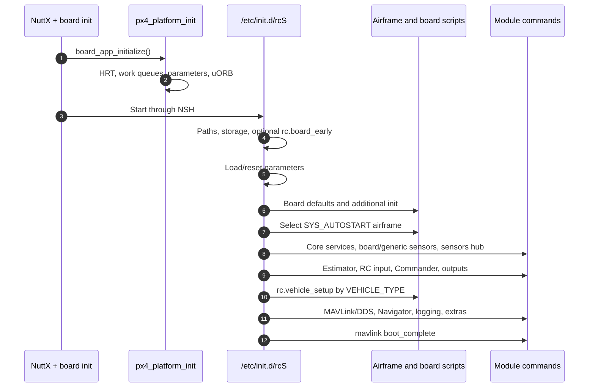
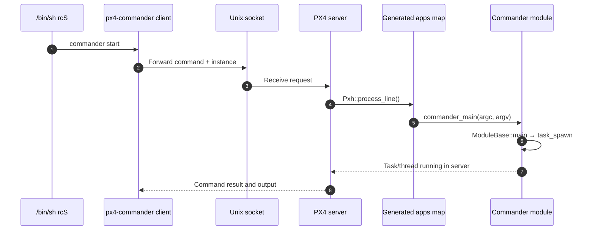

# 03 · Boot and Startup

**Previous: [02 · Build System and Configuration](02-build-system-and-configuration.md)** · **[Index](../README.md)** · Next: [04 · uORB and Module Runtime](04-uorb-and-module-runtime.md)

---

Boot is the bridge between **what was compiled** and **what actually runs**. PX4 initializes platform services first, then executes startup scripts that load parameters, select an airframe, probe board hardware, start vehicle modules, and finally enable communication and logging.

NuttX and POSIX share many script fragments and module commands, but their process models and early startup are different.

## 1. NuttX startup: reset to `rcS`

A typical flat FMU build starts through NuttX NSH. The relevant NuttX defconfig selects `nsh_main`, board initialization, and an embedded ROMFS. At a high level:

```text
architecture reset/start
    → nx_start()
    → nx_bringup()
    → mount baked ROMFS at /etc
    → start nsh_main
    → nsh_initialize()
    → boardctl(BOARDIOC_INIT)
    → board_app_initialize()
    → run rc.sysinit and /etc/init.d/rcS
    → enter NSH console
```

The NuttX submodule sources provide OS-internal details; the PX4 board and platform layers provide the autopilot-specific sequence.

### Early board initialization

A board normally has two important stages:

1. **Architecture initialization**, such as `stm32_boardinitialize()`, puts outputs into a safe state and configures essential GPIO/LED/USB behavior.
2. **`board_app_initialize()`** powers interfaces, initializes PX4 services, detects hardware revision, selects bus tables, and completes storage/peripheral setup.

For FMUv5, see `boards/px4/fmu-v5/src/init.c:161-190` and `:218-296`. The exact operations vary by board; do not copy power or reset behavior without checking the schematic.

### `px4_platform_init()`

Before normal startup scripts run, NuttX PX4 initialization creates core services (`platforms/nuttx/src/px4/common/px4_init.cpp:117-189`):

- high-resolution time and console support;
- bus and filesystem support where configured;
- PX4 work queues;
- parameters;
- uORB;
- PX4 logging.

This ordering is essential: driver startup commands can already use HRT, parameters, scheduling, and pub/sub.

### Protected-build variation

A protected FMU configuration can enter through `px4_entry` instead of directly through `nsh_main`. Userspace setup calls `boardctl(BOARDIOC_INIT)`, initializes userspace PX4 services, and then starts NSH. See `boards/px4/fmu-v5/src/stm32_userspace.c:90-143` and `platforms/nuttx/src/px4/common/px4_userspace_init.cpp:47-56`.

Do not assume flat-build address-space or interrupt behavior in a protected configuration; some uORB, HRT, and parameter operations cross the kernel/userspace boundary.

## 2. Standard NuttX `rcS`

The main script is `ROMFS/px4fmu_common/init.d/rcS`. It is an ordered composition of common and board-specific hooks.



### Ordered stages

| Stage | What happens | Source |
|---|---|---|
| Early setup | Load generated paths; optional `rc.board_early`; mount/check storage | `rcS:23-177` |
| Custom replacement | If storage contains `etc/rc.txt`, source it instead of the normal autostart body | `rcS:71-177` |
| Parameters | Load calibration/normal stores; handle autoconfig/reset | `rcS:179-262` |
| Defaults | `rc.board_arch_defaults`, `rc.board_defaults`, `rc.additional_init` | `rcS:264-295` |
| Airframe | Source generated `rc.autostart`; optional external airframes | `rcS:297-337` |
| Core services | Start tone alarm, Dataman, events, load monitor, LEDs; read `config.txt` | `rcS:339-394` |
| Sensors | Run `rc.board_sensors`, generic `rc.sensors`, then `sensors start` | `rcS:396-441` |
| Estimation | Start EKF2 and optional standalone attitude estimator according to parameters | `rcS:443-459` |
| Inputs and safety | Start RC/manual input and Commander | `rcS:505-548` |
| Outputs | Start DShot/PWM or simulated output as configured | `rcS:538-562` |
| Vehicle apps | Source `rc.vehicle_setup`, dispatched by `VEHICLE_TYPE` | `rcS:577-580` |
| Communication | Board MAVLink hooks and generated `rc.serial`; USB/Navigator | `rcS:588-678` |
| Late hooks and logs | `rc.board_extras`, `extras.txt`, logging, `rc.autostart.post` | `rcS:680-747` |
| Finish | Lock read-only parameters where configured; report boot complete | `rcS:749-797` |

### Board hooks are positional

The name of a board script communicates both content and execution point:

- `rc.board_early`: before normal storage/startup work;
- `rc.board_defaults`: board-wide parameter defaults and early board actions;
- `rc.board_sensors`: start onboard sensor drivers;
- `rc.board_mavlink`: board-specific communication setup;
- `rc.board_extras`: late board additions.

For example, FMUv5 starts LEDs and a safety button in `rc.board_defaults` (`boards/px4/fmu-v5/init/rc.board_defaults:6-25`) and starts ADC/IMU/baro/compass drivers in `rc.board_sensors` (`boards/px4/fmu-v5/init/rc.board_sensors:6-31`). Moving a command changes what has already been initialized.

> [!NOTE]
> The standard script starts with `set +e`. Optional probes and unexpected module failures do not necessarily abort boot. `mavlink boot_complete` alone does not prove every module started successfully.

## 3. Airframes and vehicle-specific startup

An airframe script combines metadata, parameter defaults, and vehicle setup. The selected `SYS_AUTOSTART` value chooses the script through generated `rc.autostart`.

Typical layers are:

```text
airframe-specific script
    → vehicle defaults (for example rc.mc_defaults)
    → VEHICLE_TYPE
    → rc.vehicle_setup
    → rc.mc_apps / rc.fw_apps / rc.vtol_apps / rover script
```

`ROMFS/px4fmu_common/init.d/rc.vehicle_setup:8-96` performs the vehicle-type dispatch. This is why changing an airframe can change both parameters and the set of running controllers.

Three customization files have different scope:

- `config.txt`: user configuration before sensor startup;
- `extras.txt`: late user additions;
- `rc.txt`: replaces the normal NuttX autostart body.

Use `param set-default` for defaults that should respect saved user values. Use `param set` only when an explicit override is intended.

## 4. Module command entry points

A modern module normally supplies a handwritten C-linkage function:

```cpp
extern "C" __EXPORT int commander_main(int argc, char *argv[])
{
    return ModuleBase::main(Commander::desc, argc, argv);
}
```

See `src/modules/commander/Commander.cpp:613-616`.

The build generates declarations and command registration, **not this function body**:

- NuttX built-in registry: `platforms/nuttx/NuttX/CMakeLists.txt:87-169`;
- POSIX declarations/map: `platforms/posix/cmake/px4_impl_os.cmake:105-237`.

`ModuleBase::main()` recognizes `start`, `stop`, `status`, help, and custom commands (`platforms/common/module_base.cpp:58-107`). A typical `start` path is:

```text
shell: commander start
    → commander_main()
    → ModuleBase::main()
    → Commander::task_spawn()
    → create task or WorkItem object
    → module enters run()/Run()
```

Stopping is cooperative: `request_stop()` sets a flag, the running module exits its execution path, and cleanup deletes the object and resets descriptor state (`platforms/common/module_base.cpp:109-187`).

## 5. POSIX/SITL startup: one server, many command clients

POSIX uses the same `px4` executable in two modes selected by `argv[0]` (`platforms/posix/src/px4/common/main.cpp:33-47`):

- `px4`: starts the PX4 server;
- `px4-<module>`: forwards a command to that server.

The server:

1. selects data, working, test-data, and startup-script paths;
2. defaults to `etc/init.d-posix/rcS`;
3. creates storage and runtime links/directories;
4. initializes PX4 platform services;
5. starts the Unix-socket command server;
6. runs `/bin/sh <startup-file> <instance>`;
7. enters PXH or waits for exit.

See `platforms/posix/src/px4/common/main.cpp:288-405` and `:581-642`.



The command clients are short-lived. Flight modules generally run as threads or work-queue items inside the server, not as independent long-lived OS processes.

`px4-alias.sh` maps NuttX-style commands to POSIX aliases and tracks the instance (`platforms/posix/src/px4/common/px4-alias.sh_in:1-22`). Server-side command dispatch is in `platforms/posix/src/px4/common/px4_daemon/pxh.cpp:76-127`.

## 6. POSIX `rcS`

The POSIX script `ROMFS/px4fmu_common/init.d-posix/rcS` differs from NuttX:

1. source `px4-alias.sh`;
2. handle replay and minimal-shell options;
3. map `PX4_SIM_MODEL` to an autostart ID unless overridden;
4. load parameters and simulation defaults;
5. source `init.d-posix/airframes/<ID>_<model>` directly;
6. start Dataman and the selected simulator bridge;
7. start core modules, sensors, Commander, and simulated outputs;
8. run shared `rc.vehicle_setup`;
9. start communication, estimators, logging, and post-airframe hooks;
10. report boot complete or start replay.

Key ranges are `rcS:8-64`, `:66-255`, `:257-295`, and `:363-401`.

> [!IMPORTANT]
> POSIX does not reproduce NuttX's `rc.board_defaults`/`rc.board_sensors` sequence. A board-only hook must not be assumed to run in SITL. Likewise, `posix-configs/` is not the main SITL startup location; it contains legacy test scripts and real Linux-board configurations.

## 7. NuttX and POSIX side by side

| Concern | NuttX | POSIX/SITL |
|---|---|---|
| Initial runtime | MCU reset and RTOS bring-up | Host `px4` process |
| Shell | NSH | `/bin/sh` startup plus PXH/server |
| Module command | NuttX built-in registry | `px4-*` client → Unix socket → generated map |
| Long-lived module context | NuttX task/pthread/work queue | Server pthread/work queue |
| Main startup script | `init.d/rcS` | `init.d-posix/rcS` |
| Board sensors | `rc.board_sensors` and generic sensor scripts | Simulator/sensor bridge according to model |
| ROMFS | Embedded read-only image | Generated runtime `etc` tree |
| Time | Hardware HRT | Host HRT or lockstep simulated HRT |
| Hardware access | NuttX/SoC/board implementation | Linux devices where supported, or simulation |

## 8. Boot-debugging checklist

When a module does not run, check in this order:

1. **Is it enabled?** Inspect the expanded `build/<config>/boardconfig`, not only the small `.px4board` overlay.
2. **Was it compiled?** Confirm its module library and `<MAIN>_main` registration exist in the build.
3. **Is there a start command?** Check `rcS`, vehicle scripts, airframe, board hooks, and user extras.
4. **Did the command execute?** Read the full console log from the beginning.
5. **Did probing fail?** For a driver, check bus, address, device ID, hardware revision, and `-q` quiet-start options.
6. **Is it running but idle?** Use `<module> status`, `work_queue status`, `uorb top`, and parameter/topic inspection as appropriate.
7. **Is another mode or flag disabling output?** Running code is not the same as publishing; many modules gate behavior on `vehicle_control_mode` or validity.
8. **Are you comparing NuttX with SITL incorrectly?** Their startup scripts and hardware entry points differ.

---

**Previous: [02 · Build System and Configuration](02-build-system-and-configuration.md)** · **[Index](../README.md)** · Next: [04 · uORB and Module Runtime](04-uorb-and-module-runtime.md)
