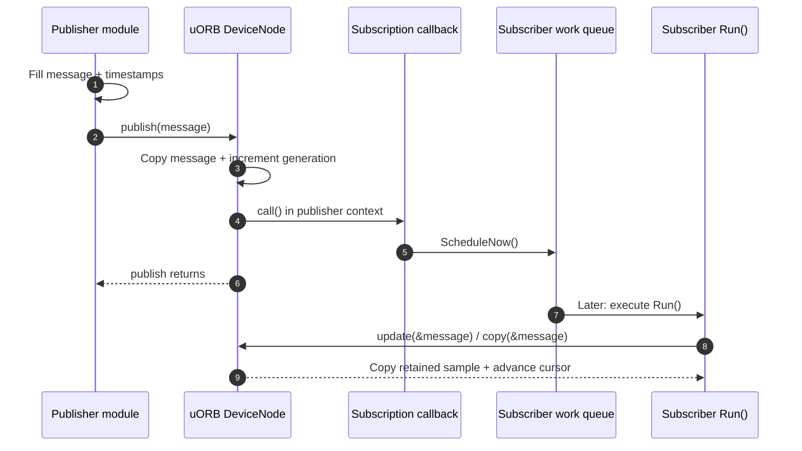
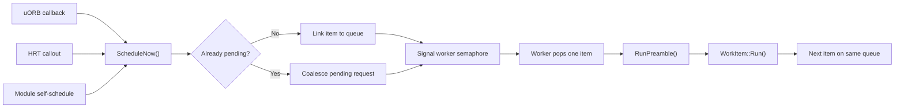

# 04 · uORB and Module Runtime

**Previous: [03 · Boot and Startup](03-boot-and-startup.md)** · **[Index](../README.md)** · Next: [05 · Drivers and Platform Abstraction](05-drivers-and-platform-abstraction.md)

---

uORB and the module runtime solve two different problems:

- **uORB moves data and signals that new data exists.**
- **HRT, tasks, and work queues decide when module code executes.**

Understanding that separation prevents most timing and threading mistakes in PX4.

## 1. From `.msg` schema to a topic

`msg/CMakeLists.txt` selects message definitions and invokes `Tools/msg/px_generate_uorb_topic_files.py` with templates under `Tools/msg/templates/uorb/`.

The generator (`Tools/msg/px_generate_uorb_topic_files.py:73-171`):

- requires a `uint64 timestamp` field;
- converts `PascalCase` filenames to `snake_case` topic/header names;
- reads optional `# TOPICS` aliases;
- sorts global topic names before assigning numeric IDs;
- generates C structs, C++ aliases, `ORB_DECLARE()` declarations, and `ORB_DEFINE()` metadata.

A generated message normally includes:

```cpp
struct vehicle_example_s { /* fields */ };
namespace px4::msg { using VehicleExample = vehicle_example_s; }
ORB_DECLARE(vehicle_example);
```

The generated source defines metadata containing name, sizes, message hash, numeric ID, and queue depth (`platforms/common/uORB/uORB.h:45-60`).

> [!WARNING]
> Generated struct fields are stably sorted by primitive size and padded; textual `.msg` order is not necessarily binary field order (`Tools/msg/templates/uorb/msg.h.em:95-114`). Use generated structs and serializers, never a hand-written memory layout.

### Timestamps are not automatic

The schema requires `timestamp`, but publication does not fill it in. Producers normally assign:

```cpp
msg.timestamp_sample = source_sample_time;
msg.timestamp = hrt_absolute_time();
pub.publish(msg);
```

`timestamp_sample` is the measurement/source time. `timestamp` is publication time. Controllers and estimators rely on this distinction.

## 2. Topic IDs, aliases, and instances

Three similar-looking concepts are different:

### Message type

The payload schema, such as `VehicleTorqueSetpoint.msg`.

### Topic alias

A separate topic name using the same payload. `VehicleTorqueSetpoint.msg:1-8` declares:

- `vehicle_torque_setpoint`
- `vehicle_torque_setpoint_virtual_fw`
- `vehicle_torque_setpoint_virtual_mc`

Each has its own `ORB_ID`; these are VTOL routing interfaces, not instance numbers.

### Runtime multi-instance

Multiple numbered nodes for the same topic metadata, such as:

```text
/obj/sensor_accel0
/obj/sensor_accel1
```

A multi-publication allocates an instance. A subscription chooses one instance explicitly; subscribing to instance 0 does not subscribe to instance 1.

`ORB_MULTI_MAX_INSTANCES` is 4 for constrained-memory builds and 10 otherwise (`platforms/common/uORB/uORB.h:62-69`). Use `orb_advertise_multi`, an instance-aware C++ publication/subscription, or `SubscriptionMultiArray` as appropriate.

### `ORB_ID(name)` versus `ORB_ID::name`

- `ORB_ID(vehicle_status)` is a pointer to `orb_metadata`.
- `ORB_ID::vehicle_status` is the generated numeric enum value.

Typed C++ wrappers accept the appropriate form; mixing them in a hand-written API call is a type error, not a style issue (`platforms/common/uORB/uORB.h:71-117`).

## 3. Runtime data structures

Each `(topic ID, instance)` maps to a `DeviceNode`. The node owns (`platforms/common/uORB/uORBDeviceNode.hpp:291-305`):

- topic metadata and instance number;
- a shared buffer of `message size × queue depth`;
- a node-wide generation counter;
- advertised/valid state;
- callback and poll-waiter state;
- subscriber count.

All subscribers of that node share the stored samples, but **each subscription has its own read cursor**. One fast reader does not consume data on behalf of another.

## 4. Advertisement and publication

### C API

```cpp
orb_advert_t pub = orb_advertise(ORB_ID(topic), &initial);
orb_publish(ORB_ID(topic), pub, &message);
```

`orb_advertise()` opens/creates the node and marks it advertised. If `data != nullptr`, it also publishes that initial sample. `orb_advertise(meta, nullptr)` does **not** publish a zero-initialized sample (`platforms/common/uORB/uORBManager.cpp:266-332`).

### Typed C++ API

```cpp
uORB::Publication<vehicle_status_s> pub{ORB_ID(vehicle_status)};
pub.publish(message); // advertises automatically on first use
```

`PublicationData<T>` additionally embeds the message and offers `get()`, `set()`, and `update()` (`platforms/common/uORB/Publication.hpp:80-128`).

### Publication copies the whole message

The write path (`platforms/common/uORB/uORBDeviceNode.cpp:138-218`):

1. allocates the buffer lazily if needed;
2. validates exact message size;
3. enters an atomic/critical section;
4. increments generation;
5. copies into the selected ring slot;
6. invokes registered callbacks;
7. marks data valid and notifies pollers.

A publisher can therefore publish a stack-local struct. Atomicity is per topic publication. There is no transaction spanning multiple topics or coordination between multiple publishers.



Publication returning does not mean subscriber processing has finished.

## 5. Subscription semantics

### Subscribe before publication

A subscriber can exist before advertisement. It receives no valid update until a publisher advertises/publishes. The C++ subscription retries lazy subscription when needed (`platforms/common/uORB/Subscription.cpp:45-74`, `:135-147`).

If retained data already exists when a subscription is created, the cursor is positioned so the latest existing publication is considered unread (`uORBDeviceNode.cpp:487-497`).

### `updated()`, `copy()`, and `update()`

| Operation | Copies payload? | Advances cursor? | Requires unread data to return success? |
|---|---:|---:|---:|
| `updated()` / `orb_check()` | No | No | It reports whether unread data exists |
| `copy(dst)` / `orb_copy()` | Yes | Yes | No; current/latest data can be copied again |
| `update(dst)` | Yes, if unread | Yes, if copied | Yes; returns false without unread data |

Use `update()` for the common “process only new data” case. It performs check-and-copy through one manager operation (`platforms/common/uORB/Subscription.cpp:92-111`).

### Depth-one topics

The default queue depth is one: the node retains only the latest value. Repeated unconditional `copy()` calls can return that same current value again. `update()` returns false until a new generation arrives.

Depth-one is suitable for state such as `vehicle_status` or a latest setpoint, not for streams where every sample matters.

### Queued topics

A message can declare, for example:

```text
uint8 ORB_QUEUE_LENGTH = 8
```

`SensorAccel.msg:17-19` does this. With a queue:

- each update consumes the next unread retained sample;
- a slow reader can miss intermediate samples;
- if it falls too far behind, its cursor jumps to the oldest retained sample;
- after the queue is drained, unconditional `copy()` may return the latest sample again while `update()` returns false.

Queue overflow is data loss by design, not a guaranteed backpressure mechanism.

### Rate-limited subscriptions

`SubscriptionInterval` reports an update only when data is unread **and** the minimum interval since the last successful copy has elapsed (`platforms/common/uORB/SubscriptionInterval.cpp:45-83`). It does not schedule the module and does not replace a timer, poll loop, or callback.

## 6. Callbacks run in publisher context

A common declaration is:

```cpp
uORB::SubscriptionCallbackWorkItem sub{
    this, ORB_ID(vehicle_angular_velocity)
};
sub.registerCallback();
```

On publication, `SubscriptionCallbackWorkItem::call()` applies optional count/interval gates and calls `ScheduleNow()` (`platforms/common/uORB/SubscriptionCallback.hpp:126-178`). It does **not** invoke the module's `Run()` directly.

Consequences:

- callback code runs on the publisher's thread/context;
- on NuttX uORB publication, it can run inside an interrupt-critical section;
- callbacks must be short and nonblocking;
- module work happens later on the destination queue;
- derived callback objects must unregister before derived teardown (`SubscriptionCallback.hpp:69-74`).

Plain subscription objects are intended for single-threaded use unless externally synchronized. Do not share one subscription cursor between unrelated threads.

## 7. `ModuleBase`: lifecycle, not scheduling

The analyzed revision uses a non-template, descriptor-based `ModuleBase` (`platforms/common/include/px4_platform_common/module.h:67-95`). Each module supplies a static `Descriptor` with:

- `task_spawn` function;
- optional custom-command and usage functions;
- atomic running-object pointer;
- task ID.

`ModuleBase` implements `start`, `stop`, `status`, and cleanup (`platforms/common/module_base.cpp:58-187`). Its global lifecycle mutex protects startup/shutdown transitions, not arbitrary module data. `status` and custom commands can execute in a different context from the running module.

Two execution styles exist:

### Dedicated task/thread: lowercase `run()`

`task_spawn()` calls `px4_task_spawn_cmd()`. A trampoline instantiates the object and calls lowercase virtual `run()` (`module_base.cpp:206-229`). The loop typically polls, sleeps, and exits when `should_exit()` becomes true.

### Shared work queue: uppercase `Run()`

`task_spawn()` constructs a `WorkItem`-derived object and sets `desc.task_id = task_id_is_work_queue`. No dedicated task is created. The worker later calls uppercase virtual `Run()` (`platforms/common/px4_work_queue/WorkQueue.cpp:191-216`).

## 8. Work queues

`WorkQueueManager` defines named queues such as `rate_ctrl`, `nav_and_controllers`, `INS0`–`INS3`, per-SPI/I2C queues, `hp_default`, and `lp_default` (`platforms/common/include/px4_platform_common/px4_work_queue/WorkQueueManager.hpp:44-103`). Configuration includes stack and priority.

A `WorkItem` attaches to a queue at construction. `ScheduleNow()` only enqueues it and signals the worker (`platforms/common/px4_work_queue/WorkItem.cpp:119-131`).



### Serial execution and coalescing

All items on one queue run serially. A slow `Run()` delays every other item on that queue.

Repeated scheduling while an item is pending can coalesce into one pending execution. A work queue is not an event queue containing one entry per publication. If every sensor sample matters, use a suitable uORB queue and drain it in `Run()`.

A schedule arriving while the item is running can enqueue a later run. `WorkItem::Deinit()` prevents new insertion, removes pending work, and waits for in-flight execution when destruction happens on another thread (`WorkItem.cpp:88-117`).

## 9. `ScheduledWorkItem` and HRT

`ScheduledWorkItem` owns an HRT callout and provides (`platforms/common/px4_work_queue/ScheduledWorkItem.cpp:40-75`):

- `ScheduleDelayed(delay_us)` — one shot;
- `ScheduleOnInterval(interval_us, delay_us)` — periodic;
- `ScheduleAt(time_us)` — absolute deadline;
- `ScheduleClear()` — cancel.

The HRT trampoline only calls `ScheduleNow()`. Module logic still runs on the work queue.

`ScheduleOnInterval(interval)` has an immediate first deadline by default. Periodic deadlines are based on scheduled times, reducing long-term drift, but queue contention still creates execution jitter and can coalesce runs.

A common robust pattern is:

```text
primary: new gyro sample schedules Run()
backup: ScheduleDelayed(timeout) detects missing input
inside Run(): perform work, then arm backup again
```

## 10. HRT and platform differences

`hrt_abstime` is a microsecond `uint64_t`. HRT provides monotonic time and nonblocking callouts (`src/drivers/drv_hrt.h:56-87`).

| Platform | Implementation summary |
|---|---|
| NuttX/STM32 | Hardware timer; due callouts run from timer ISR; 64-bit extension of hardware counter |
| POSIX without lockstep | `CLOCK_MONOTONIC`; timer processing is placed on a high-priority HRT work queue |
| POSIX with lockstep | Time and sleeps follow the simulation scheduler |
| Protected NuttX userspace | Calls cross through `boardctl`; a user HRT thread handles user callouts |

`hrt_elapsed_time()` returns zero for a future timestamp, avoiding unsigned underflow (`platforms/common/hrt.cpp:36-48`).

Tasks also differ:

- NuttX uses `task_create()` or `kthread_create()` and scheduler priority setup (`platforms/nuttx/src/px4/common/tasks.cpp:60-89`).
- POSIX creates a pthread and maps it into PX4's task table; real-time creation can fall back if permission is denied (`platforms/posix/src/px4/common/tasks.cpp:106-273`).

Use PX4 wrappers such as `px4_poll()` instead of assuming a PX4 device handle is a native host file descriptor.

## 11. Lockstep in one paragraph

With lockstep enabled, POSIX HRT reads `LockstepScheduler` time and sleeps wait for simulated deadlines (`platforms/posix/src/px4/common/drv_hrt.cpp:469-537`). Work queues register while busy and unregister when drained. A simulator can wait for registered components before returning actuator controls.

This coordinates logical time and component progress. It does not remove host-thread jitter, and different simulator bridges do not necessarily implement the same explicit barrier. See [12](12-simulation-testing-and-replay.md).

## 12. Runtime rules and pitfalls

1. **Advertisement is not initial publication.** Supply initial data if subscribers must immediately copy a value.
2. **Do not perform first-time lazy publication from an ISR.** Buffer allocation/advertisement must be completed from thread context first (`uORBDeviceNode.cpp:138-185`).
3. **Callbacks execute on the publisher.** Only schedule or signal; never perform substantial work there.
4. **HRT callouts are not module execution.** Keep them nonblocking and schedule work.
5. **A work item is not a per-message event queue.** Pending schedules coalesce.
6. **Depth-one topics lose intermediate history by design.** Use queued topics when every sample matters.
7. **`copy()` and `update()` are not interchangeable.** Unconditional copy can repeat old data.
8. **`SubscriptionInterval` does not schedule anything.** It only gates reported updates.
9. **One slow module delays its entire work queue.** Queue choice is part of real-time design.
10. **Periodic HRT does not guarantee periodic completion.** Worker contention adds latency.
11. **Lifecycle locking does not make module fields thread-safe.** Protect command/status shared state explicitly.
12. **No cross-topic atomic snapshot exists.** Document publication order and which topic triggers the consumer.
13. **Instance number is not persistent device identity.** Use device IDs/calibration slots where identity matters.
14. **Initialize timestamps explicitly.** uORB does not do it for you.

---

**Previous: [03 · Boot and Startup](03-boot-and-startup.md)** · **[Index](../README.md)** · Next: [05 · Drivers and Platform Abstraction](05-drivers-and-platform-abstraction.md)
