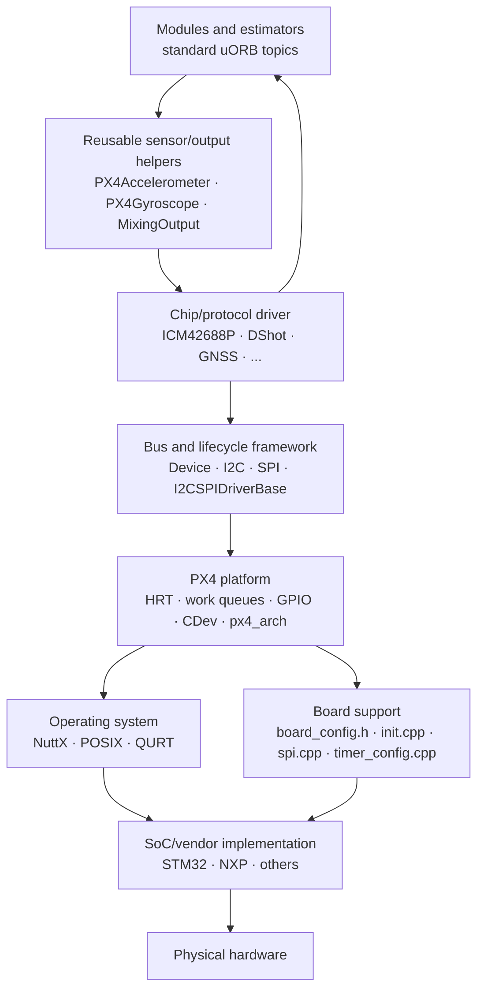
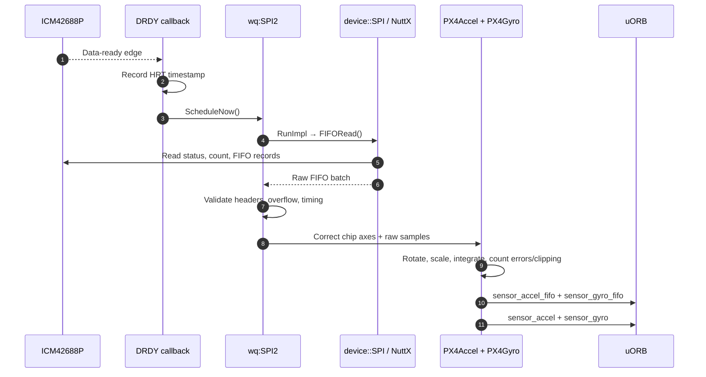
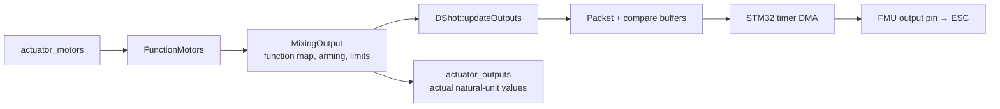

# 05 · Drivers and Platform Abstraction

**Previous: [04 · uORB and Module Runtime](04-uorb-and-module-runtime.md)** · **[Index](../README.md)** · Next: [06 · Sensors and State Estimation](06-sensors-and-state-estimation.md)

---

PX4 separates **what a chip does** from **where that chip is connected**. A reusable IMU driver understands registers, FIFO records, scaling, and error recovery. The board describes the SPI bus, chip select, data-ready pin, rotation, and timer/DMA resources. The platform maps common operations to NuttX, POSIX, QURT, or another target.

This separation is the reason one driver can support many flight controllers without filling the driver with board-specific conditionals.

## 1. Layer model



The boundaries are intentional but not absolute: board and `px4_arch` code is vendor-specific by design. Portable chip drivers should stay above those details.

## 2. Board configuration anatomy

A board commonly contains:

| File/directory | Responsibility |
|---|---|
| `default.px4board`, other `*.px4board` | PX4 Kconfig feature selection |
| `nuttx-config/<config>/defconfig` | RTOS architecture, subsystems, peripheral enablement |
| `nuttx-config/include/board.h` | Clock tree and NuttX/SoC pin encodings |
| `src/board_config.h` | Runtime PX4 board contract: power, versions, ADC, timers, GPIO |
| `src/init.cpp` | Safe early state, power sequencing, platform and hardware-revision initialization |
| `src/spi.cpp`, `src/i2c.cpp` | Bus topology, device types, CS/DRDY, internal/external classification |
| `src/timer_config.cpp` | Output timers, channels, DMA capability |
| `src/CMakeLists.txt` | Board-source build rules |
| `src/hw_config.h` | Bootloader configuration, not normal runtime sensor setup |
| `init/rc.board_*` | Startup hooks and onboard driver start lines |

> [!NOTE]
> Older PX4 guides may start with `board.cmake`. No `board.cmake` files exist in this revision. Use `.px4board`, Kconfig, and `boards/<vendor>/<model>/src/CMakeLists.txt`.

### Three similar headers, three different jobs

- **`src/board_config.h`** describes the running PX4 board.
- **`nuttx-config/include/board.h`** describes clocks and pins to NuttX/SoC code.
- **`src/hw_config.h`** describes bootloader flash/interface behavior.

Do not use the bootloader header as the runtime pin map.

## 3. Platform families

| Platform | Verified role in this revision |
|---|---|
| NuttX | Primary MCU/RTOS path: early board init, NSH built-ins, flat/protected builds, SoC bus/timer/HRT backends, VFS devices |
| POSIX | SITL and Linux-based boards: host process, pthreads, host HRT/lockstep, Linux device support where available |
| QURT | Qualcomm Hexagon/SLPI implementation with POSIX-compatible PX4 interfaces and vendor bus callbacks |
| ROS 2 | Separate target with ROS interface generation; not a NuttX board-support layer |

NuttX SoC selections in this tree include several STM32 families, NXP K66/i.MXRT/S32K, RP2040, ESP32, and others (`platforms/nuttx/cmake/px4_impl_os.cmake:139-189`).

POSIX hardware support is conditional. For example, Linux SPI uses `/dev/spidev<bus>.<cs>` (`src/lib/drivers/device/posix/SPI.cpp:45-53`, `:87-120`), while the device CMake only selects Linux I2Cdev/SPIdev implementations on suitable Unix targets (`src/lib/drivers/device/CMakeLists.txt:34-53`). macOS SITL should use simulated sensors rather than expect physical bus access through that backend.

## 4. Device and bus abstractions

### `device::Device`

`src/lib/drivers/device/Device.hpp:74-186` provides common initialization/read/write/ioctl templates and a packed device ID containing bus type, bus number, address/instance, and sensor type. Device IDs are more suitable for persistent identity than uORB instance order.

### `device::CDev`

The character-device layer maps VFS-like operations to C++ objects on NuttX and emulates device/file handles on POSIX. However, a modern sensor can inherit this infrastructure without registering its own `/dev` node. `device::CDev::init()` registers a node only when a device name is supplied (`src/lib/drivers/device/CDev.cpp:56-77`).

An ICM42688P therefore uses SPI plus uORB; users do not normally read samples from an ICM-specific character device.

### `device::I2C` and `device::SPI`

Chip drivers include the selector `src/lib/drivers/device/spi.h` or `i2c.h`, which chooses the target implementation. The NuttX SPI path (`src/lib/drivers/device/nuttx/SPI.cpp:86-180`):

1. initializes the bus;
2. probes the chip through the virtual driver method;
3. selects frequency/mode/word size per transfer;
4. locks as required;
5. asserts CS, performs NuttX `SPI_EXCHANGE`, then deasserts CS.

The chip driver calls `transfer()`, not STM32 registers or Linux ioctls directly.

### `px4_arch` shims

Common code uses functions such as `px4_arch_configgpio`, `px4_arch_gpiosetevent`, and `px4_spibus_initialize`. Architecture headers map these to SoC/NuttX implementations. For STM32 examples, see `platforms/nuttx/src/px4/stm/stm32_common/include/px4_arch/micro_hal.h:93-103`.

## 5. Board bus descriptions and enumeration

SPI board tables describe:

- physical bus number;
- internal/external/shared topology;
- CS and DRDY pins;
- PX4 driver device type;
- optional bus-power GPIO;
- locking requirements.

The common structure is in `platforms/common/include/px4_platform_common/spi.h:52-83`. Boards with hardware revisions can provide multiple tables; `px4_set_spi_buses_from_hw_version()` selects one (`platforms/common/spi.cpp:44-86`).

Common CLI options include (`platforms/common/i2c_spi_buses.cpp:106-225`):

- `-I` / `-X`: internal/external I2C;
- `-s` / `-S`: internal/external SPI;
- `-a`: I2C address;
- `-b`: bus;
- `-f`: frequency;
- `-q`: quiet/optional start.

`BusInstanceIterator` matches the requested bus and driver type against board entries. The board start line supplies configuration; the chip driver does not hardcode the physical connection.

## 6. `I2CSPIDriverBase` lifecycle

A typical driver inherits both a bus class and `I2CSPIDriver<T>`:

```cpp
class ICM42688P : public device::SPI, public I2CSPIDriver<ICM42688P>
```

The two bases solve different problems:

- `device::SPI`: identity and bus transfers;
- `I2CSPIDriver<T>`: command lifecycle, instance list, work-queue scheduling.

`module_start()` (`platforms/common/i2c_spi_buses.cpp:656-716`):

1. iterates matching board devices;
2. avoids duplicate instances;
3. selects a work queue from the bus;
4. builds `I2CSPIDriverConfig`;
5. constructs and probes the instance on that queue;
6. records successful instances.

SPI bus numbers map to queues such as `wq:SPI2`. Running construction and WHOAMI probing on the bus queue avoids arbitrary startup-thread bus access and serializes devices sharing that bus.

## 7. Detailed example: ICM42688P to uORB

This example uses FMUv6X where the board revision provides an ICM42688P. Not every FMUv6X revision contains that chip; `boards/px4/fmu-v6x/init/rc.board_sensors` selects drivers by detected hardware.

### Build and board declaration

- Driver enabled: `boards/px4/fmu-v6x/default.px4board:29`.
- SPI entry: `boards/px4/fmu-v6x/src/spi.cpp:43-45` associates the ICM42688P device type with SPI2, CS PH5, and DRDY PA10 on the described revision.
- Driver start: `boards/px4/fmu-v6x/init/rc.board_sensors:109-115` supplies internal-SPI selection and rotation.

### Probe and configuration

`icm42688p_main()` configures SPI-only common arguments and default frequency (`src/drivers/imu/invensense/icm42688p/icm42688p_main.cpp:52-91`). Construction creates the bus object, scheduled driver, `PX4Accelerometer`, and `PX4Gyroscope` (`ICM42688P.cpp:49-76`).

`ICM42688P::RunImpl()` advances through (`ICM42688P.cpp:151-228`):

```text
RESET → WAIT_FOR_RESET → CONFIGURE → FIFO_RESET → FIFO_READ
```

WHOAMI and register verification detect wrong/missing hardware. Repeated transfer failures or configuration mismatches trigger reset recovery.

### DRDY only schedules work

When DRDY is available, its interrupt callback stores an HRT timestamp and calls `ScheduleNow()` (`ICM42688P.cpp:504-533`). A delayed backup handles missed interrupts. Without DRDY, the driver schedules periodic FIFO reads.

The SPI transaction happens later on `wq:SPI2`, **not in the GPIO ISR**.



### Publication helpers

`PX4Accelerometer.cpp:167-225` and `PX4Gyroscope.cpp:166-224` apply rotation/scaling and publish:

- raw FIFO batches: `sensor_accel_fifo`, `sensor_gyro_fifo`;
- integrated/averaged per-update reports: `sensor_accel`, `sensor_gyro`.

Messages include device ID, scale, timestamps, sample count, temperature, and error/clipping information where applicable. Downstream sensor and estimator code does not need to know the IMU's register format.

## 8. Detailed example: `actuator_motors` to DShot

Control Allocation publishes normalized `actuator_motors` (`src/modules/control_allocator/ControlAllocator.cpp:744-805`). `FunctionMotors` receives them, and `MixingOutput` applies logical-to-physical function assignment, arming, disarmed/min/max/failsafe values, ramp/limits, and invokes the concrete driver (`src/lib/mixer_module/mixer_module.cpp:421-538`).

For DShot (`src/drivers/dshot/DShot.cpp:84-170`, `:372-407`):

1. read configured timer modes and output functions;
2. convert mixer values to DShot-domain integers;
3. send zero/commands for non-motor, disarmed, or stopped channels as required;
4. construct 16-bit packets: 11 throttle/command bits, telemetry bit, 4 checksum bits;
5. expand bits into timer compare values;
6. start timer DMA bursts.

The STM32 backend is in `platforms/nuttx/src/px4/stm/stm32_common/dshot/dshot.c:384-478` and `:911-975`.

FMUv6X's `boards/px4/fmu-v6x/src/timer_config.cpp:59-80` shows why board data matters: only timers with DMA mappings can use this DShot backend. A pin's existence does not imply DShot capability.



PX4IO is a separate serial output path, not part of direct FMU DShot. PWM shares `MixingOutput` but writes timer compare registers instead.

## 9. Adding a board: practical sequence

1. Clone the closest board by **SoC, clock/DMA architecture, and bus model**, not just connector shape.
2. Add `default.px4board` and deliberate variant overlays.
3. Supply NuttX defconfig, clocks/pins, linker scripts, and architecture configuration.
4. Implement `board_config.h`, `init.cpp`, bus tables, timer configuration, and board `src/CMakeLists.txt`.
5. Put outputs in a safe reset state before peripheral startup.
6. Implement power sequencing and hardware-revision detection exactly as required by the schematic.
7. Ensure NuttX peripherals and PX4 bus/timer tables agree.
8. Add `rc.board_sensors` start lines with correct bus, address, device type, and rotation.
9. Add bootloader `hw_config.h` and firmware metadata only if supplying a bootloader.
10. Validate every hardware revision, DMA conflict, missing-sensor path, and stop/start path.

## 10. Adding an I2C/SPI driver: practical sequence

1. Add leaf `Kconfig` and `CMakeLists.txt` with unique `MODULE` and `MAIN` names.
2. Allocate a stable `DRV_*_DEVTYPE_*` in `src/drivers/drv_sensor.h` where required by enumeration.
3. Derive from `device::I2C`/`SPI` plus `I2CSPIDriver<T>`.
4. Implement robust `probe()`, `init()`, nonblocking `RunImpl()`, status, and cleanup.
5. Use common bus CLI options and the correct default frequency.
6. Keep DRDY callbacks limited to timestamping and scheduling.
7. Use `PX4Accelerometer`, `PX4Gyroscope`, or the appropriate helper instead of reimplementing calibration/publication behavior.
8. Preserve device ID, internal/external classification, sample time, units, rotation, and error counters.
9. Add board start lines and hardware-revision conditions explicitly.
10. Test absent device, wrong identity, bus errors, overflow, missed DRDY, reset, and repeated start/stop—not only valid samples.

## 11. Driver/platform pitfalls

- A compiled driver still needs a start command.
- A board can include several sensor drivers because different revisions use different chips; inclusion does not prove presence.
- Do not access a shared bus from an ISR.
- Do not assume an I2C/SPI driver must expose a character device.
- Do not derive persistent calibration identity from uORB instance order.
- Do not confuse `board_config.h`, NuttX `board.h`, and bootloader `hw_config.h`.
- Do not assume every PWM timer supports DShot; DMA mapping matters.
- POSIX does not imply simulation, and simulation does not use the same physical bus backend as Linux hardware.
- Quiet probing (`-q`) is suitable for optional peripherals, but it can hide a missing mandatory onboard sensor if used indiscriminately.

---

**Previous: [04 · uORB and Module Runtime](04-uorb-and-module-runtime.md)** · **[Index](../README.md)** · Next: [06 · Sensors and State Estimation](06-sensors-and-state-estimation.md)
