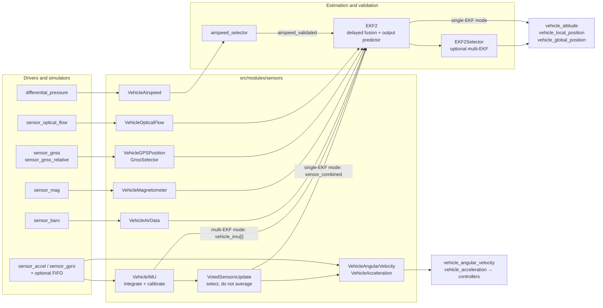
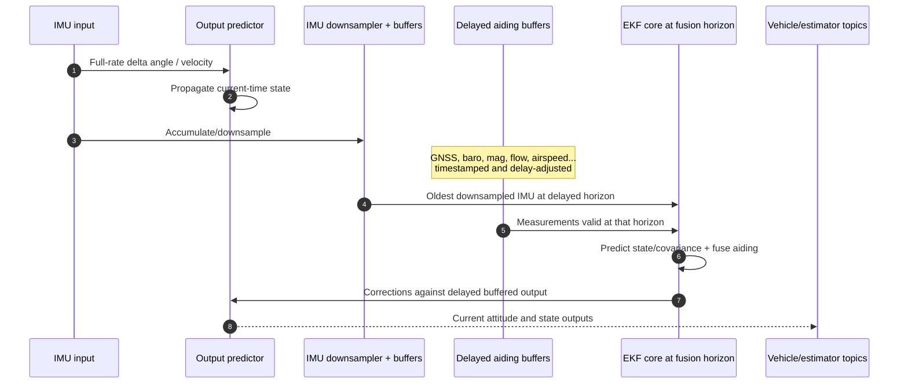

# 06 · Sensors and State Estimation

**Previous: [05 · Drivers and Platform Abstraction](05-drivers-and-platform-abstraction.md)** · **[Index](../README.md)** · Next: [07 · Flight Control Pipeline](07-flight-control-pipeline.md)

---

PX4's sensor architecture has three related but distinct paths:

1. **Estimator IMU path:** driver samples → `VehicleIMU` integration → selected IMU data → EKF2.
2. **Control-rate IMU path:** selected gyro/accel → filtering and bias correction → `vehicle_angular_velocity` / `vehicle_acceleration` for controllers.
3. **Aiding-sensor paths:** barometer, magnetometer, GNSS, airspeed, optical flow, range, and external vision → EKF2 measurement buffers.

These paths share calibration and device identity, but they are not interchangeable. In particular, `vehicle_angular_velocity` is a control input, not EKF2's IMU input.

## 1. End-to-end data map



## 2. Important topics and ownership

| Stage | Topic(s) | Producer → consumer |
|---|---|---|
| Raw/integrated IMU | `sensor_accel`, `sensor_gyro`, optional `*_fifo` | Chip/simulator drivers → sensor processors |
| Integrated body IMU | `vehicle_imu`, `vehicle_imu_status` | One `VehicleIMU` per accel/gyro instance pair → selection or multi-EKF |
| Selected IMU | `sensor_combined`, `sensor_selection` | `VotedSensorsUpdate` → single EKF2 and control-side selection |
| Control-rate inertial | `vehicle_angular_velocity`, `vehicle_acceleration` | Selected/filtered/bias-corrected streams → controllers |
| Air data | `vehicle_air_data` | Selected/calibrated barometer plus derived altitude/density → EKF2 |
| Magnetic field | `vehicle_magnetometer` | Selected instance or multiple instances → EKF2 |
| GNSS | `vehicle_gnss`, `vehicle_gnss_heading` | Receiver checks/selection → EKF2 |
| Airspeed | multi-instance `airspeed` → single `airspeed_validated` | Per-sensor conversion → independent selector → EKF2/FW modules |
| Estimator instance output | `estimator_attitude`, `estimator_local_position`, etc. | Multi-EKF instances → `EKF2Selector` |
| System state | `vehicle_attitude`, `vehicle_local_position`, `vehicle_global_position`, `vehicle_odometry` | EKF2 directly or selected republication → controllers/services |

Message schemas under `msg/` are the authoritative field/unit references.

## 3. Startup and discovery

Board/simulator drivers start before the `sensors` hub. `Sensors` constructs `VotedSensorsUpdate`, starts angular-velocity/acceleration processing, loads calibration, and attempts initial IMU construction (`src/modules/sensors/sensors.cpp:48-83`).

While disarmed, it periodically discovers newly advertised sensor groups (`sensors.cpp:479-550`). A `VehicleIMU` is created only when matching numbered `sensor_accel[i]` and `sensor_gyro[i]` both exist (`sensors.cpp:383-416`). The common driver helpers advertise early to keep those instance numbers aligned.

Each `VehicleIMU`:

- advertises output;
- loads calibration;
- registers a gyro-driven callback;
- keeps a backup schedule (`vehicle_imu/VehicleIMU.cpp:50-95`).

Most sensor parameter changes are deferred until disarm. Disabling an IMU is different because it immediately stops the paired output and must be handled safely (`sensors.cpp:164-180`).

## 4. IMU integration

Drivers can publish FIFO batches and averaged reports. `VehicleIMU` consumes the **averaged** `sensor_accel` and `sensor_gyro`, not the raw FIFO arrays.

Its processing (`vehicle_imu/VehicleIMU.cpp:169-265`, `:281-356`, `:410-485`):

1. drains queued accel and gyro samples;
2. detects uORB generation gaps and timing anomalies;
3. uses `timestamp_sample` differences for integration `dt`;
4. applies trapezoidal integration;
5. adds gyro coning compensation;
6. chooses reset sample counts near `IMU_INTEG_RATE`;
7. publishes only when accel and gyro integration windows are ready.

On output (`VehicleIMU.cpp:539-675`):

- calibration is applied to average rate, then converted back to corrected deltas;
- `timestamp_sample` is the last gyro sample timestamp;
- delta times, clipping, device IDs, and calibration counters are included;
- `vehicle_imu_status` precedes `vehicle_imu` so status is available with the sample.

`VehicleImu.msg:1-23` defines delta angle/velocity semantics.

## 5. Calibration and identity

### Calibration is applied in stages

Driver helpers handle chip-to-PX4 axis correction, configured rotation, and basic scaling. Calibration classes then apply device-specific offset, scale, rotation, and thermal correction.

Representative formulas (`src/lib/sensor_calibration/`):

```text
accel = R × ((data - thermal_offset - offset) ⊙ scale)
gyro  = R × (data - thermal_offset - offset)
```

Internal sensors follow board rotation; external sensors use calibration rotation. Board level adjustment can be included.

### uORB instance is not persistent identity

Calibration lookup matches the hardware **device ID** against `CAL_<TYPE><slot>_ID` entries (`src/lib/sensor_calibration/Utilities.cpp:48-125`). This allows a saved calibration to survive changes in advertisement order.

Nevertheless, accel/gyro pairing uses matching uORB instance numbers. Both facts matter: instance pairs define the processing stream, while device IDs define persistent calibration identity.

### Thermal and learned bias paths

`temperature_compensation` publishes `sensor_correction` when temperature-dependent offsets change (`src/modules/temperature_compensation/TemperatureCompensationModule.cpp:143-197`). Calibration objects select corrections by device ID.

EKF2 publishes `estimator_sensor_bias`. Its uses include:

- subtracting primary-estimator bias from control-side angular velocity/acceleration;
- optional learned calibration and eventual disarmed parameter saving;
- invalidating old learned bias when device ID or calibration count changes.

`VehicleIMU` does **not** subtract the current EKF bias before sending data to EKF2; EKF2 estimates those biases itself. Control-side `VehicleAngularVelocity` and `VehicleAcceleration` do subtract primary-estimator bias (`vehicle_angular_velocity/VehicleAngularVelocity.cpp:928-947`, `vehicle_acceleration/VehicleAcceleration.cpp:237-259`).

## 6. Sensor “voting” means selection, not averaging

`VotedSensorsUpdate` reads enabled `vehicle_imu` instances and selects accel/gyro sources using health, priority, and confidence (`voted_sensors_update.cpp:76-158`, `:320-384`).

It does not numerically average or majority-vote IMU values into a synthetic sensor.

Selection considers:

- configured priority;
- fresh and changing data;
- timeout and error counts;
- internal/external defaults;
- estimator inconsistency feedback where applicable.

Priority 0 disables selection. A failed sensor's runtime priority can be demoted rather than disappearing from diagnostics. Disabling either accel or gyro removes the paired IMU from publication/selection.

The selected `sensor_combined` contains selected accel and gyro data. `sensor_selection` communicates device IDs and selection changes. Health/inconsistency metrics are published separately on `sensors_status_imu`.

### Single-EKF and multi-EKF input modes

- `SENS_IMU_MODE=1`: sensors hub owns normal selection and publishes `sensor_combined` for a single EKF2 input path.
- `SENS_IMU_MODE=0`: multi-EKF instances consume assigned `vehicle_imu` streams; `EKF2Selector` supplies selected IDs after initialization.

The exact input conversion is visible in `src/modules/ekf2/EKF2.cpp:655-790`: normal mode reconstructs deltas from `sensor_combined` rates and integration times; multi mode reads `vehicle_imu` deltas directly.

## 7. Control-rate angular velocity and acceleration

`VehicleAngularVelocity` (`vehicle_angular_velocity/VehicleAngularVelocity.cpp:230-369`, `:791-957`):

1. validates the selected gyro against fresh `vehicle_imu_status`;
2. prefers matching fresh `sensor_gyro_fifo`, otherwise uses `sensor_gyro`;
3. filters every raw FIFO sample and retains the final filtered value;
4. computes angular acceleration from the rate sequence;
5. applies calibration and subtracts primary-estimator gyro bias;
6. forces reselection after prolonged missing publication.

This produces `vehicle_angular_velocity`, which drives `mc_rate_control` and other consumers. It is intentionally separate from the integrated EKF path.

`VehicleAcceleration` performs analogous selection, filtering, calibration, and bias correction for `vehicle_acceleration`.

## 8. Aiding-sensor pipelines

### Barometer → `vehicle_air_data`

`VehicleAirData` supports multiple barometers, applies offset/thermal calibration, computes QNH-adjusted altitude for validation, selects a healthy source, and derives QNH-referenced barometric altitude above mean sea level and air density (`vehicle_air_data/VehicleAirData.cpp:139-355`, `msg/VehicleAirData.msg:1-14`). This is distinct from pressure altitude relative to the standard pressure datum.

Additional behavior includes secondary-baro ground alignment, optional GNSS-based offset calibration, and demotion on EKF barometer fault. EKF2 consumes QNH-referenced barometric altitude and density and can reset learning when device/calibration identity changes (`EKF2.cpp:2369-2403`).

### Magnetometer → `vehicle_magnetometer`

`VehicleMagnetometer` applies offset, scale/off-diagonal calibration, rotation, optional throttle/current compensation, and learned estimator-bias removal (`vehicle_magnetometer/VehicleMagnetometer.cpp:460-539`).

- `SENS_MAG_MODE=1`: publish only the selected healthy magnetometer.
- `SENS_MAG_MODE=0`: publish enabled fresh instances for multi-magnetometer EKF configurations (`:567-630`).

### GNSS → `vehicle_gnss`

`VehicleGPSPosition` supports two receivers in this revision. It resolves calibration slots, corrects timestamps, runs strict/relaxed checks, and feeds `GnssSelector` (`vehicle_gps_position/VehicleGPSPosition.cpp:197-280`).

Checks include fix quality, satellites, accuracy, spoofing/jamming, and at-rest behavior (`src/lib/gnss/gnss_checks.cpp:51-154`). The selector handles silence, availability, preferred receivers, rank hold, and switching (`GnssSelector.cpp:182-385`).

Timing has three stages:

1. driver `timestamp_sample` if valid;
2. configured receiver delay otherwise;
3. PPS/UTC mapping when fresh and sane (`PpsTimeSync.cpp:44-100`).

EKF2 accepts usable samples, applies antenna lever-arm corrections, and resets/restarts relevant state on receiver selection changes because position/geoid references can differ.

### Differential pressure → validated airspeed

One `VehicleAirspeed` per differential-pressure instance averages samples, removes offset, uses selected air data, computes IAS/TAS, and publishes multi-instance `airspeed` (`vehicle_airspeed/VehicleAirspeed.cpp:96-185`).

The separate `airspeed_selector` runs validators and wind estimators, selects a valid source, and publishes `airspeed_validated` (`src/modules/airspeed_selector/airspeed_selector_main.cpp:613-672`, `:765-824`). Fallback can include ground-speed-minus-wind or synthetic airspeed depending on configuration.

EKF2 prefers validated airspeed and has a bounded fallback to raw instance 0 after validated data has been unavailable (`EKF2.cpp:2254-2314`).

### Optical flow

`VehicleOpticalFlow` accumulates flow, rotates pixel measurements, averages quality/distance, and uses sensor-provided delta angle or integrates selected calibrated gyro over the flow interval (`vehicle_optical_flow/VehicleOpticalFlow.cpp:98-281`, `:352-468`). EKF2 converts accumulated values to rates and shifts timestamps to the integration midpoint before buffering (`EKF2.cpp:2557-2624`).

## 9. EKF2: delayed fusion with current-time output

EKF2 must combine high-rate IMU data with sensors that have different rates and delays. It does this by maintaining a **delayed fusion horizon** while using an **output predictor** for current-time state.



### Input and downsampling

`EstimatorInterface::setIMUData()` first updates the output predictor at every input sample, then accumulates/downsamples IMU toward `EKF2_PREDICT_US` (`src/modules/ekf2/EKF/estimator_interface.cpp:86-128`).

The downsampler accumulates delta time, clipping, quaternion delta angle, and rotated delta velocity (`EKF/imu_down_sampler/imu_down_sampler.cpp:10-68`). Buffer lengths derive from delay and prediction settings (`estimator_interface.cpp:614-643`).

Aiding timestamps are delay-adjusted and inserted into buffers. `Ekf::update()` consumes the oldest downsampled IMU, predicts state/covariance, controls fusion, and corrects the output predictor (`EKF/ekf.cpp:139-197`).

### Output predictor

The output predictor (`EKF/output_predictor/output_predictor.cpp:184-361`, `:413-448`):

- integrates full-rate IMU deltas at the current horizon;
- removes latest EKF-estimated IMU biases;
- buffers inertial states;
- compares delayed output with delayed EKF state;
- applies attitude, velocity, and position corrections;
- corrects for configured IMU lever arm.

It is not another EKF and not the multi-EKF selector.

`EKF2.cpp:853-918` shows publication timing:

- position, odometry, bias, wind, and detailed status publish after `_ekf.update()` succeeds;
- `PublishAttitude()` runs on every IMU input when valid, using the output-predictor quaternion.

## 10. Multi-EKF and `EKF2Selector`

Multi-EKF configuration can create instances for selected IMU/magnetometer combinations. Each instance:

- consumes assigned `vehicle_imu` and optional `vehicle_magnetometer` instance;
- runs on an associated INS work queue;
- publishes `estimator_*` rather than system `vehicle_*` outputs (`EKF2.cpp:3033-3200`, `:423-452`).

The selector monitors `estimator_status`, test ratios, filter faults, timeouts, and IMU inconsistency (`EKF2Selector.cpp:160-375`, `:713-874`). Health hysteresis and minimum dwell reduce unnecessary switching.

On selection it:

- republishes the chosen estimator streams as `vehicle_*` topics;
- publishes selected sensor IDs;
- moves callbacks;
- maintains system-wide reset counters and reset deltas across switches.

It does **not** blend estimator states. Reset bookkeeping is essential so consumers can handle discontinuities explicitly (`EKF2Selector.cpp:377-555`, `:604-710`).

## 11. Standalone `attitude_estimator_q`

`attitude_estimator_q` is a separate complementary quaternion estimator. It consumes `sensor_combined`, propagates with gyro, applies accel/mag or external-heading corrections, and publishes only `vehicle_attitude` (`src/modules/attitude_estimator_q/attitude_estimator_q_main.cpp:203-224`, `:428-575`).

It does not provide local/global position or participate in `EKF2Selector`. `ATT_EN` defaults off and is labeled unsupported in this revision. Startup refuses to coexist silently with another fresh attitude publisher (`:185-200`).

## 12. Estimation contributor pitfalls

1. **Do not feed `vehicle_angular_velocity` to EKF2 as a replacement for integrated IMU input.** It serves control and has different filtering/bias handling.
2. **Preserve `timestamp_sample`.** Publication time cannot reconstruct delayed measurement timing.
3. **Use device IDs and calibration counters.** Runtime instance order can change.
4. **Selection is not blending.** Switching can create discontinuities; publish/reset counters and deltas correctly.
5. **Do not subtract EKF bias twice.** Estimator IMU and control-rate paths intentionally differ.
6. **Aiding availability is not active fusion.** Runtime enable, source availability, data validity, and fusion health are separate states.
7. **Do not assume all wind topics are interchangeable.** `wind`, `estimator_wind`, and `airspeed_wind` have different producers and purposes.
8. **Changing estimator output requires checking reset semantics.** Controllers and selector logic rely on them.
9. **Test failover and stale data.** A single healthy-sensor test does not exercise the architecture's difficult paths.
10. **Use verbose estimator logs for diagnosis.** Test ratios, innovations, status flags, timestamps, and selection history explain more than final position alone.

---

**Previous: [05 · Drivers and Platform Abstraction](05-drivers-and-platform-abstraction.md)** · **[Index](../README.md)** · Next: [07 · Flight Control Pipeline](07-flight-control-pipeline.md)
