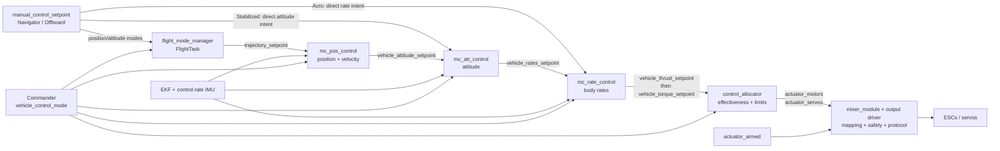

# 07 · Flight Control Pipeline

**Previous: [06 · Sensors and State Estimation](06-sensors-and-state-estimation.md)** · **[Index](../README.md)** · Next: [08 · Commander, Modes, and Failsafes](08-commander-modes-and-failsafes.md)

---

The control pipeline reduces high-level intent into increasingly concrete commands:

```text
manual / autonomous / offboard intent
    → trajectory or guidance setpoints
    → attitude setpoint
    → body-rate setpoint
    → torque + body-thrust setpoints
    → normalized motor/servo commands
    → physical output values
```

Not every mode uses every stage. Stabilized manual can enter at attitude control, Acro at rate control, Offboard at several levels, and rovers bypass aircraft torque/thrust allocation.

## 1. Multicopter spine



`vehicle_control_mode` enables stages. It does not route the setpoint payloads; publishers and topic contracts determine the data path.

## 2. Current message contracts

| Stage | Topic | Meaning |
|---|---|---|
| Selected pilot input | `manual_control_setpoint` | Arbitrated sticks, switches, validity, and source |
| Outer-loop trajectory | `trajectory_setpoint` | Local NED position, velocity, acceleration, jerk, yaw/yaw rate; NaN means uncontrolled components |
| Attitude command | `vehicle_attitude_setpoint` | Desired quaternion, yaw move rate, normalized body thrust |
| Rate command | `vehicle_rates_setpoint` | Body roll/pitch/yaw rates, body thrust, integral-reset flag |
| Allocation input | `vehicle_torque_setpoint` | Normalized torque about body X/Y/Z |
| Allocation input | `vehicle_thrust_setpoint` | Normalized body thrust; special NaN motor-stop semantics |
| Motor command | `actuator_motors` | Up to 12 normalized controls; non-reversible normally `[0,1]`, reversible `[-1,1]`, NaN stopped |
| Servo command | `actuator_servos` | Up to 15 normalized controls in `[-1,1]`; NaN disarmed |
| Driver result | `actuator_outputs` | Up to 16 values in natural output units—not universally normalized |
| Output safety | `actuator_armed` | Armed, prearmed, lockdown, kill, termination, and related flags |
| Allocation feedback | `control_allocator_status` | Unallocated torque/thrust, saturation, handled failures |

Sign conventions matter:

- multicopter collective thrust is normally **negative body Z**;
- fixed-wing forward thrust is normally **positive body X**.

Do not use old `actuator_controls_0/1` assumptions for current commands. `actuator_controls_status_0/1` are status topics, not the modern normalized motor/servo command interface.

## 3. Manual input and mode entry points

`rc_update` calibrates hardware/override RC into `manual_control_input`. MAVLink `MANUAL_CONTROL` and DDS can publish the same message type at that stage. `manual_control` validates and selects a source, then republishes it as `manual_control_setpoint` (`src/modules/manual_control/ManualControl.cpp:90-196`, `ManualControlSelector.cpp:36-135`).

For multicopters:

- **Position/altitude modes:** FlightTasks turn sticks or navigation into `trajectory_setpoint`.
- **Stabilized:** `mc_att_control` creates attitude and thrust directly from sticks, bypassing position control (`mc_att_control_main.cpp:145-212`).
- **Acro/manual rate:** `mc_rate_control` creates body-rate and thrust setpoints directly from sticks (`MulticopterRateControl.cpp:128-189`).
- **Offboard:** Commander's flags select trajectory, attitude, rate, thrust/torque, or direct-actuator entry according to `offboard_control_mode`.
- **Autonomous:** Navigator triplets pass through `FlightTaskAuto` to a smoothed local trajectory.

Publishing a setpoint does not by itself select a path; the corresponding control-mode flags must enable the consumer.

## 4. `flight_mode_manager`: mode to trajectory

`flight_mode_manager` is paced by local-position updates with a subscription interval (`FlightModeManager.cpp:82-123`). It selects a FlightTask using navigation state and control flags (`:139-283`):

- Auto for internal autonomous modes;
- Position, Altitude, Descend, Orbit, Follow Target, Transition, and related tasks for their modes;
- fallback through simpler tasks and ultimately `FlightTaskFailsafe` when activation/update fails.

It publishes `trajectory_setpoint` and `vehicle_constraints` (`:336-367`). Task activation passes the previous task's trajectory to preserve continuity.

For manual position/altitude modes, tasks consume selected sticks through the `Sticks` helper and apply deadzone, expo, and configured limits. Invalid/lost input is zeroed by the helper rather than silently retaining an old stick command.

## 5. `mc_pos_control`: position to attitude and thrust

`mc_pos_control` runs when multicopter position-related control is enabled. It consumes trajectory, constraints, state estimates, land detection, and hover-thrust estimate (`MulticopterPositionControl.cpp:448-643`).

The cascade in `PositionControl/PositionControl.cpp:102-273` is:

1. **Position P loop:** position error plus finite feed-forward produces a velocity setpoint, limited horizontally and vertically.
2. **Velocity PID loop:** velocity error produces acceleration; finite acceleration feed-forward is added.
3. **Acceleration to thrust/attitude:** desired acceleration and gravity define body-Z direction and collective thrust; tilt and thrust constraints are applied.
4. **Output:** desired thrust vector and yaw become `vehicle_attitude_setpoint`; corrected internal setpoints are also published for diagnostics.

NaN-aware validation allows a mode to control only selected axes. Limits include velocity, tilt/slew, minimum/maximum thrust, horizontal-thrust margin, vertical-priority saturation, and anti-windup.

If the main update fails, the controller first reuses a recent valid setpoint, then generates a failsafe setpoint. Depending on valid state it can stop and wait, descend at landing speed, or perform a blind descent (`MulticopterPositionControl.cpp:605-715`). This local controller fallback is separate from Commander's failsafe state machine.

## 6. `mc_att_control`: attitude to body rates

`mc_att_control` runs on `vehicle_attitude` updates.

In Stabilized manual, it maps:

- roll/pitch sticks to a maximum-tilt-limited rotation;
- yaw stick through yaw-setpoint generation;
- throttle through a configurable curve with hover/min/max slew constraints.

Otherwise it consumes an upstream attitude setpoint.

The controller (`mc_att_control_main.cpp:251-389`, `AttitudeControl/AttitudeControl.cpp:65-214`):

- validates the desired quaternion;
- maintains a second-order attitude reference model;
- computes reduced-attitude error, prioritizing roll/pitch over yaw;
- applies proportional gains and reference/feed-forward rates;
- enforces per-axis rate limits;
- adapts the reference to estimator quaternion resets.

It publishes `vehicle_rates_setpoint` with body thrust carried forward.

## 7. `mc_rate_control`: body rates to torque and thrust

The rate controller is scheduled by `vehicle_angular_velocity` and uses corrected angular velocity plus angular acceleration (`MulticopterRateControl.cpp:108-143`).

The shared `RateControl` law (`src/lib/rate_control/rate_control.cpp:71-118`) is conceptually:

```text
torque = P × rate_error + integral - D × measured_angular_acceleration + FF × rate_setpoint
```

Integral handling includes landed state, per-axis limits, large-error reduction, and blocking in the direction of allocator saturation. The module consumes `control_allocator_status.unallocated_torque` for anti-windup and can apply gain compression and yaw-torque filtering.

Non-finite torque is replaced with zero, outputs are constrained, and the module publishes **thrust first, torque second** (`MulticopterRateControl.cpp:271-277`). Both use the gyro sample timestamp.

That order matters: torque schedules Control Allocation, which reads the latest thrust. It is an application convention, not an atomic two-topic transaction.

## 8. Control Allocation

Control Allocation converts this six-axis command:

```text
[roll torque, pitch torque, yaw torque, thrust X, thrust Y, thrust Z]
```

into actuator commands using configured effectiveness geometry.

### Effectiveness model

For each rotor, geometry includes position relative to CG, thrust axis, thrust coefficient `CT`, and moment coefficient `KM`. The implemented relationships (`ActuatorEffectivenessRotors.cpp:142-220`) are:

```text
thrust_i = CT_i × axis_i
moment_i = CT_i × position_i × axis_i - CT_i × KM_i × axis_i
```

These fill columns of an effectiveness matrix. Fixed-wing surfaces contribute configured roll/pitch/yaw torque coefficients; flaps and spoilers are handled as auxiliary controls.

`CA_METHOD` selects pseudo-inverse with clipping, pseudo-inverse with sequential desaturation, or automatic selection (`src/modules/control_allocator/module.yaml:11-116`). A basic pseudo-inverse allocation uses:

```text
actuator_setpoint = actuator_trim + mix × (control_setpoint - control_trim)
```

Sequential desaturation goes beyond independent clipping by adjusting allocation according to control priorities and airmode behavior.

### Allocation order

`ControlAllocator.cpp:378-465` performs, in order:

1. read/sanitize torque;
2. read thrust and record NaN-axis motor stops;
3. check failures and update effectiveness if needed;
4. build six-axis vector(s);
5. apply actuator-group preflight overrides;
6. allocate;
7. apply auxiliary controls and effectiveness-specific updates;
8. apply stopped-motor NaNs;
9. apply slew limiting;
10. clip to actuator min/max;
11. check health and publish commands/status.

Motor limits are normally `[0,1]`; reversible motors can use `[-1,1]`; servos use `[-1,1]`. `CA_Rn_SLEW` and `CA_SVn_SLEW` describe minimum time to traverse the full range, not arbitrary units/second.

### Failure handling

With failure handling enabled, a reported failed motor's effectiveness column can be removed. Supported hexarotor configurations can additionally stop the opposite motor or make it reversible with reduced reverse effectiveness (`ControlAllocator.cpp:838-895`).

`control_allocator_status` reports achieved/unallocated commands, saturation, and failure masks. Rate controllers use unallocated torque for anti-windup.

## 9. Output functions and `mixer_module`

Two configuration layers are easy to confuse:

### Vehicle geometry

`CA_AIRFRAME`, `CA_ROTORn_*`, surface geometry, effectiveness method, slew, and failure parameters describe how torque/thrust maps to logical actuators.

### Physical output assignment

Each output driver has a prefix such as `PWM_MAIN`, `UAVCAN_EC`, or `DSHOT`. Per-channel parameters include:

```text
<prefix>_FUNCn
<prefix>_DISn
<prefix>_MINn
<prefix>_CENTn
<prefix>_MAXn
<prefix>_FAILn
<prefix>_REV
```

`FUNCn` assigns Motor 1, Servo 2, or another function to a physical channel (`src/lib/mixer_module/mixer_module.cpp:112-132`, `output_functions.yaml:1-18`). Correct rotor geometry does not automatically select the correct pin.

`mixer_module` is therefore **not the legacy geometry mixer**. It is the shared library that:

- subscribes to output-function providers;
- maps normalized commands to configured ranges;
- handles disarmed/min/center/max/failsafe values;
- enforces armed, prearm, lockdown, kill, and termination behavior;
- optionally ramps outputs after arming;
- calls the concrete driver's `updateOutputs()`;
- publishes actual `actuator_outputs` (`mixer_module.cpp:421-701`).

For non-reversible motors, zero command maps to minimum configured output; a stopped motor is represented by NaN/disarmed semantics. Zero and NaN are not interchangeable.

`CA_R_REV` describes reversible motor thrust. `<prefix>_REV` reverses a physical output interval. They solve different problems.

## 10. Fixed-wing comparison

Fixed-wing startup runs its own mode manager and control chain (`ROMFS/px4fmu_common/init.d/rc.fw_apps:8-20`):

```text
Navigator / manual / Offboard
    → fw_mode_manager
    → fixed_wing_lateral_setpoint + fixed_wing_longitudinal_setpoint
    → fw_lat_lon_control
    → vehicle_attitude_setpoint
    → fw_att_control
    → vehicle_rates_setpoint
    → fw_rate_control
    → torque + positive-X thrust
    → Control Allocation
```

The source directory is `fw_lateral_longitudinal_control`, but the executable is `fw_lat_lon_control`.

`fw_lat_lon_control` combines lateral guidance with TECS for altitude/height-rate and airspeed/energy control, producing roll, pitch, and throttle (`FwLateralLongitudinalControl.cpp:205-345`). This is not the multicopter position/velocity PID cascade.

`fw_att_control` adds attitude control, turn-coordination feed-forward, rate limits, and runway-wheel output. `fw_rate_control` adds airspeed-based effectiveness/trim scaling, gain compression, allocation feedback, and roll-to-yaw feed-forward (`FixedwingRateControl.cpp:287-482`).

In direct manual mode, sticks and trim can map directly to normalized torque/throttle while retaining the same allocation/output interface.

## 11. VTOL routing and transitions

VTOL runs MC and FW controller families plus `vtol_att_control` (`ROMFS/px4fmu_common/init.d/rc.vtol_apps:11-41`). Controllers publish virtual topics:

| Source | Virtual attitude | Virtual allocation outputs |
|---|---|---|
| MC controllers | `mc_virtual_attitude_setpoint` | `vehicle_torque_setpoint_virtual_mc`, `vehicle_thrust_setpoint_virtual_mc` |
| FW controllers | `fw_virtual_attitude_setpoint` | `vehicle_torque_setpoint_virtual_fw`, `vehicle_thrust_setpoint_virtual_fw` |

`vtol_att_control` selects/blends/routes them into actual attitude and torque/thrust instances (`vtol_att_control_main.cpp:331-469`). Control Allocation commonly uses two matrices: motors/tilts in instance 0 and aerodynamic surfaces in instance 1.

- **Standard VTOL:** ramps pusher and MC authority, stops unused vertical motors in forward flight.
- **Tiltrotor:** adds `tiltrotor_extra_controls`; effectiveness updates rotor axes and tilt servos.
- **Tailsitter:** rotates frames through transition and swaps allocation direction masks.

Transitions can be requested by switch/action or vehicle command. Completion and quad-chute checks consider time, airspeed, altitude loss, descent, and attitude (`vtol_type.cpp:178-201`, `:331-400`). Quad-chute is separate from Control Allocation's motor-failure handling.

## 12. Rover comparison

Current rover modules are:

- `rover_ackermann`
- `rover_differential`
- `rover_mecanum`

They do not use the aircraft torque/thrust Control Allocation path. Their conceptual cascade is:

```text
rover position/course setpoint
    → speed + attitude setpoints
    → throttle + rate setpoints
    → steering setpoint
    → actuator_motors and/or actuator_servos directly
    → shared mixer_module/output drivers
```

`rover_steering_setpoint` is a normalized `[-1,1]` steering command for Ackermann and a normalized left/right speed difference for differential/Mecanum (`msg/RoverSteeringSetpoint.msg:1-4`). Each vehicle implements its own inverse kinematics and stop behavior. After normalized actuator messages, rovers rejoin the same output-function and safety layer as aircraft.

## 13. Control-pipeline pitfalls

1. **Do not bypass `vehicle_control_mode` accidentally.** Topic presence alone does not authorize a controller.
2. **Do not bypass final output safety.** Control Allocation output is still subject to `actuator_armed` and `MixingOutput`.
3. **Do not confuse `mixer_module` with geometry allocation.** They are separate layers.
4. **Do not assume zero means stopped.** NaN has specific stopped/disarmed meaning in motor paths.
5. **Do not assume `actuator_outputs` is normalized.** It uses natural driver units.
6. **Preserve thrust-before-torque publication when changing that interface.** Allocation triggers on torque and polls thrust.
7. **Handle saturation feedback.** Otherwise integrators can wind up when requested motion is physically impossible.
8. **VTOL virtual topics are not normal allocator inputs.** `vtol_att_control` performs routing to actual instances.
9. **Geometry and pin assignment are separate.** Verify both `CA_*` and `<prefix>_FUNCn` configuration.
10. **Rovers are different.** Their modules directly publish normalized actuator commands.
11. **Test mode entry at the correct cascade level.** A position test will not exercise direct rate or direct actuator behavior.
12. **Respect NaN, frame, and unit contracts.** A numerically plausible command can mean something completely different at another stage.

---

**Previous: [06 · Sensors and State Estimation](06-sensors-and-state-estimation.md)** · **[Index](../README.md)** · Next: [08 · Commander, Modes, and Failsafes](08-commander-modes-and-failsafes.md)
