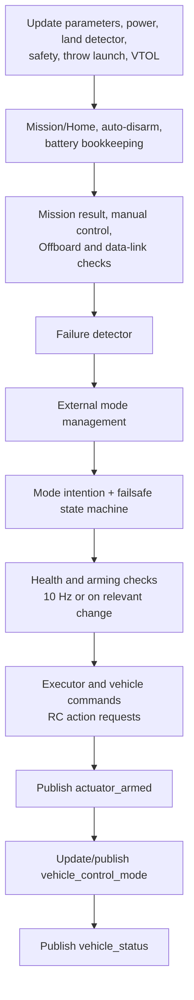
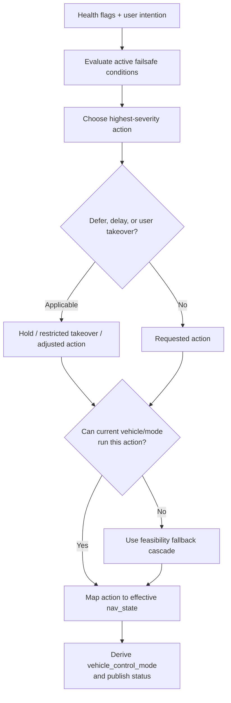

# 08 · Commander, Modes, and Failsafes

**Previous: [07 · Flight Control Pipeline](07-flight-control-pipeline.md)** · **[Index](../README.md)** · Next: [09 · Missions, Navigation, and Autonomy](09-missions-navigation-and-autonomy.md)

---

Commander owns the vehicle's operating authority. It decides whether the vehicle can arm, which navigation state is effective after user intention and failsafes, which controllers are enabled, and what output-facing arming state applies.

The central boundary is:

> **Commander decides whether and how the vehicle may operate; Navigator decides what an autonomous mode should do next; controllers decide how to track the resulting setpoint.**

## 1. Ownership boundaries

| Component | Owns | Does not own |
|---|---|---|
| Commander | Arming, mode intention/effective state, health checks, failsafe action, external executor authority, `vehicle_status`, `vehicle_control_mode`, `actuator_armed` | Mission traversal and waypoint generation |
| Navigator | Mission/RTL/Loiter/Takeoff/Land state machines, `position_setpoint_triplet`, mission and geofence results | Arming, controller-enable flags, direct actuator commands |
| Mode managers / FlightTasks | Vehicle-specific local trajectory/guidance generation | Top-level arm and failsafe authority |
| Controllers | Tracking trajectory, attitude, rate, torque/thrust, and normalized actuators | Whether a mode may run |
| Land/failure/battery checks | Evidence and health/failsafe flags | Independently changing mode, except through Commander's response |

Commander publishes `actuator_armed`, `vehicle_control_mode`, and `vehicle_status` in that order at 2 Hz or immediately on change (`src/modules/commander/Commander.cpp:2152-2184`).

## 2. Related state is not interchangeable

| Field/topic | Meaning |
|---|---|
| `vehicle_status.nav_state_user_intention` | Requested high-level mode after accounting for external replacement |
| `vehicle_status.nav_state` | Effective current mode after failsafe action and external replacement |
| `vehicle_status.nav_state_display` | User-visible mode, potentially owned by an executor |
| `vehicle_status.executor_in_charge` | Executor currently allowed to issue commands; zero means autopilot |
| `vehicle_status.arming_state` | Main armed/disarmed state |
| `vehicle_control_mode` | Controller-enable bitset derived from effective mode and setpoint type |
| `actuator_armed` | Output-facing armed, prearmed, readiness, kill, lockdown, and termination state |
| `health_report` | Per-mode `can_arm` and `can_run` health verdicts |

Definitions are in `msg/versioned/VehicleStatus.msg:27-71`, `msg/VehicleControlMode.msg:1-17`, and `msg/ActuatorArmed.msg:1-9`.

`handleModeIntentionAndFailsafe()` computes the effective state rather than simply copying a user-selected mode (`Commander.cpp:2547-2604`). MAVLink heartbeat uses `nav_state_display`, so protocol display state may differ from the internal effective state (`src/modules/mavlink/streams/HEARTBEAT.hpp:79-111`).

## 3. Commander main loop

In the analyzed revision, Commander runs a 10 ms loop. Its ordering is deliberate (`Commander.cpp:2026-2204`):



Commands are handled after system state is refreshed. Health checks run after the failsafe update in an iteration, so failsafe logic can act on the most recently stored flags rather than checks recomputed later in that same pass.

## 4. Arming and disarming

### Arming

`Commander::arm()` (`Commander.cpp:667-753`):

1. rejects arming during calibration;
2. checks throttle position when manual control is used;
3. reruns health/arming checks as an actual arming request;
4. requires `canArm(current nav_state)`;
5. optionally captures Home;
6. records armed time, state, and reason.

Throttle convention depends on mode: rover near center, climb-rate modes at/below center, and direct-thrust modes near minimum.

A limited RC-switch re-arm grace path can skip repeated preflight checks after accidental disarm. Forced/internal command behavior is not identical to normal external arming and should not be treated as a general bypass.

### Prearm is separate

Prearm is computed into `actuator_armed.prearmed`; it is not another `vehicle_status.arming_state`. `COM_PREARM_MODE` selects disabled, when-safety-off, or always behavior (`Commander.cpp:2282-2306`).

### Disarming and auto-disarm

Normal disarm generally requires landed/maybe-landed or a ground vehicle, with limited forced/manual exceptions (`Commander.cpp:756-810`). It also restores stored user mode, clears takeoff state, updates flight UUID, and handles safety state.

Auto-disarm has separate paths for:

- after takeoff followed by landing (`COM_DISARM_LAND`), subject to mission/executor restrictions;
- excessive preflight inactivity before takeoff (`COM_DISARM_PRFLT` plus spool-up);
- kill-switch-related forced disarm (`Commander.cpp:2503-2544`).

## 5. User mode intention and health checks

`UserModeIntention::change()` (`UserModeIntention.cpp:44-100`) implements mode-selection rules:

- external replacement is mapped to the internal mode it replaces;
- disarmed selection is generally allowed, but that is not a safety approval for flight;
- armed changes require `HealthAndArmingChecks.canRun()`;
- some modes allow configured fallback while preserving intention;
- termination cannot be exited through a normal mode change.

### `HealthAndArmingChecks`

The framework (`HealthAndArmingChecks/HealthAndArmingChecks.cpp:54-115`):

1. resets a report;
2. establishes vehicle/mode requirements;
3. runs an ordered list of checks;
4. finalizes `can_arm` and `can_run` bitsets;
5. emits events and health reports;
6. publishes `failsafe_flags` on change or periodically.

Checks cover estimator state, Home, mission, Offboard, external components, battery, RC/data links, geofence, failure detector, arming authorization, and mode-specific requirements. Check order is intentional (`HealthAndArmingChecks.hpp:181-224`).

Examples of static requirements (`ModeUtil/mode_requirements.cpp:64-203`):

- Manual: manual control.
- AltCtl: angular velocity, attitude, local altitude, manual control.
- PosCtl: AltCtl needs plus relaxed local position.
- Mission: attitude/rate, altitude, mission validity, wind/flight-time compliance, and position requirements appropriate to vehicle type.
- RTL: position requirements, Home, and no-arm/takeoff restrictions.
- Land/Descend: prevent normal arming.

`ModeChecks` converts requirements and failure flags into arming failures and clears corresponding `can_run` bits (`checks/modeCheck.cpp:36-159`).

## 6. Failsafe state machine

Failsafe action severity is ordered (`commander/failsafe/framework.h:52-70`):

```text
None < Warn < FallbackPosCtrl < FallbackAltCtrl < FallbackStab
     < Hold < RTL < Land < Descend < Disarm < Terminate
```

The update algorithm (`framework.cpp:53-110`, `:442-495`):

1. clears actions whose arm/disarm/mode-change clear conditions fired;
2. re-evaluates active conditions;
3. removes inactive actions;
4. selects the highest-severity valid action;
5. applies deferral, delayed Hold, user takeover, and mode-feasibility fallback;
6. maps the result to an effective navigation state.

While disarmed, actions normally resolve to None; termination is special and sticky.

### Feasibility fallback

A requested action is not always possible. The viability cascade is (`framework.cpp:546-627`):

```text
FallbackPosCtrl → FallbackAltCtrl → FallbackStab → Hold → RTL
                → Land → Descend → Terminate
```

Disarm is handled separately, including vehicle-specific safe-disarm behavior.

`COM_FAIL_ACT_T` can temporarily turn a delayed action into Hold. User takeover is restricted by the most restrictive active action. Geofence failsafe cannot be deferred.



### Mode-specific examples

- PosCtl can degrade through AltCtl to Stabilized when required estimates degrade.
- Offboard loss follows `COM_OBL_RC_ACT`, then generic feasibility fallback.
- An intended mode that cannot run can lead to RTL and then further fallback.
- RC loss behavior is configurable and is not synonymous with one fixed action.

## 7. How control flags are derived

`ModeUtil/control_mode.cpp:46-157` maps effective mode and setpoint type to `vehicle_control_mode` flags. Examples:

| Mode/type | Enabled path |
|---|---|
| Manual | Manual input; attitude/rates for rotary wing or direct thrust/torque as appropriate |
| Stabilized | Manual input + attitude + rates |
| Acro | Manual input + rates |
| AltCtl | Manual + trajectory-related vertical/attitude/rate stages; horizontal position/velocity disabled |
| PosCtl | Manual + position/trajectory cascade |
| Internal autonomous triplet | Auto flag + normal cascade + allocation |
| Descend | Automatic climb-rate/attitude/rate/allocation without full XY position control |
| Termination | Controller flags cleared |
| Offboard | Flags selected by `offboard_control_mode` type priority |

Offboard priority is:

```text
position → velocity → acceleration → attitude → body_rate
         → thrust_and_torque → direct_actuator
```

These flags enable consumers. The external producer must still publish the correct topic with valid frames, units, timestamps, and NaN semantics.

## 8. Offboard health and lifecycle

Classic Offboard requires a recent `offboard_control_mode` with at least one supported control bit. Position additionally needs valid local position, velocity needs valid local velocity, and acceleration/attitude needs valid attitude (`HealthAndArmingChecks/checks/offboardCheck.cpp:38-116`).

The heartbeat is **`offboard_control_mode` publication**, not the mere existence of an old setpoint. MAVLink reception publishes that liveness message and only forwards setpoints when the vehicle accepts them (`src/modules/mavlink/mavlink_receiver.cpp:1323-1344`).

A companion should therefore stream valid Offboard control-mode messages before requesting Offboard and continue streaming them while active.

## 9. External modes and executors

Classic Offboard, `NAVIGATION_STATE_EXTERNAL1...8`, and mode executors are related but distinct mechanisms.

`ModeManagement` supports registration of (`ModeManagement.cpp:252-378`):

- external arming checks;
- external modes;
- executors;
- replacement of an internal mode;
- immediate activation and Offboard-setpoint requests.

External arming checks use `arming_check_request` and `arming_check_reply`. Replies provide `can_arm_and_run`, events, and mode requirements. Missing responses eventually mark the component unresponsive (`checks/externalChecks.cpp:134-338`).

An external mode replacing an internal mode is converted to the internal mode for intention/health evaluation and mapped back when responsive. If unresponsive, the internal mode is used (`ModeManagement.cpp:487-524`).

A real failsafe action above Warn returns executor authority to the autopilot and revokes the external executor's command-forwarding authority (`ModeManagement.cpp:562-580`).

Normal internal MC/FW task managers disable their internal path for external modes. External modes are not simply additional Navigator mission states.

## 10. Failure detector, land detector, and battery evidence

These modules feed Commander rather than owning top-level mode transitions:

- **FailureDetector:** attitude/altitude/motor-related failure evidence; checks are conditioned on control state (`commander/failure_detector/FailureDetector.cpp:51-81`).
- **Land detector:** landed/maybe-landed/takeoff evidence used by auto-disarm, mission completion, controller integrators, and arming logic.
- **Battery checks:** battery level, remaining-time, and RTL-estimate comparisons produce warning/failsafe flags. `rtlEstimateCheck()` compares safe return time with worst connected battery remaining time (`HealthAndArmingChecks/checks/batteryCheck.cpp:358-384`).
- **Geofence result:** Navigator detects a breach; Commander applies configured action.

This separation keeps measurement and policy separate: producers report evidence, Commander selects the authoritative response.

## 11. Commander contributor pitfalls

1. **User intention is not effective mode.** Always distinguish `nav_state_user_intention`, `nav_state`, and display state.
2. **Disarmed mode selection is not flight-worthiness approval.** Armed changes use `canRun`; arming uses `canArm`.
3. **Prearm is not armed.** Output code must honor the full `actuator_armed` contract.
4. **Do not add a second top-level mode switch in Navigator or a controller.** Route authority through Commander.
5. **Failsafe severity is not enough.** Feasibility, deferral, user takeover, and clear conditions also matter.
6. **Do not assume a requested RTL/Land action is always possible.** Follow the fallback cascade.
7. **Offboard setpoints are not the liveness heartbeat.** Maintain `offboard_control_mode`.
8. **Controller flags do not route messages.** Producers and consumers still need correct topic interfaces.
9. **External executor authority is revocable.** Failsafe returns control to the autopilot.
10. **Command processing order matters.** New checks should preserve state-update and publication ordering.
11. **Health flags and mode requirements are different layers.** Valid/selectable mode masks are not a complete real-time health verdict.
12. **Test transitions, not just steady states.** Arm, mode entry, sensor degradation, takeover, failsafe clear, landing, and disarm form the real contract.

---

**Previous: [07 · Flight Control Pipeline](07-flight-control-pipeline.md)** · **[Index](../README.md)** · Next: [09 · Missions, Navigation, and Autonomy](09-missions-navigation-and-autonomy.md)
