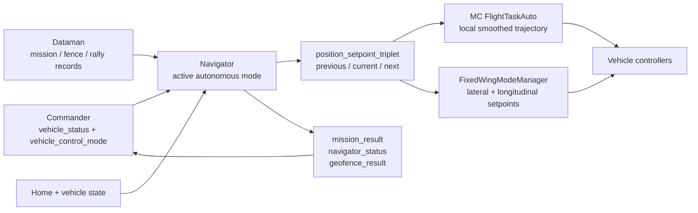
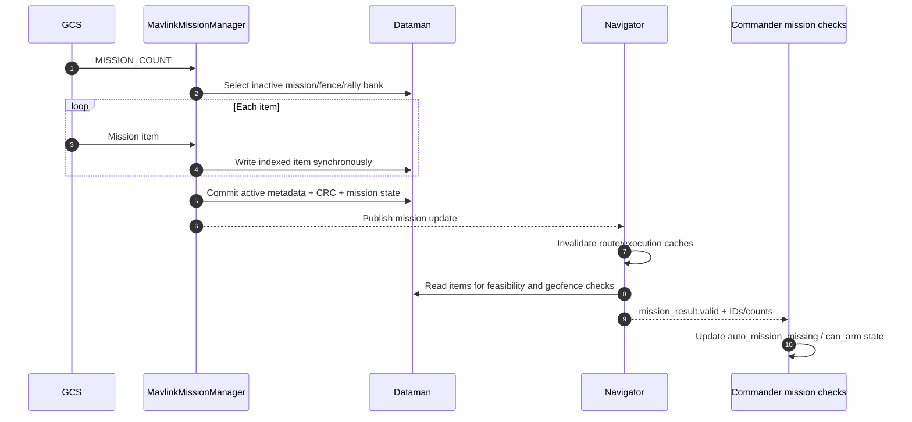
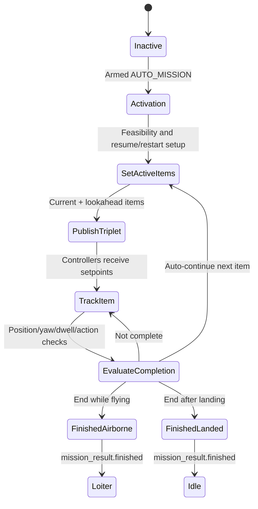

# 09 · Missions, Navigation, and Autonomy

**Previous: [08 · Commander, Modes, and Failsafes](08-commander-modes-and-failsafes.md)** · **[Index](../README.md)** · Next: [10 · Communication and ROS 2](10-communication-and-ros2.md)

---

Navigator converts Commander's effective autonomous navigation state into navigation setpoints. It owns mission traversal, Return behavior, Loiter, Takeoff, Land, geofence checking, and related state machines. It does not decide whether the vehicle may arm and does not directly command motors.

## 1. Navigator's place in the stack



Navigator subscribes to `vehicle_status` and publishes `position_setpoint_triplet`, `mission_result`, `navigator_status`, `geofence_result`, and `mode_completed` (`src/modules/navigator/navigator.h:369-395`).

While disarmed, no Navigator mode is active. Modes still receive `run(false)`, allowing inactive housekeeping such as estimate updates (`navigator_main.cpp:1080-1109`, `navigator_mode.cpp:67-74`). Commander must first select and permit an armed autonomous state.

## 2. Navigation setpoint contracts

### `position_setpoint_triplet`

This is global navigation intent with previous/current/next `position_setpoint` values (`msg/PositionSetpointTriplet.msg:1-8`). In this revision, `PositionSetpoint.type` has position, velocity, loiter, takeoff, land, and idle values (`msg/PositionSetpoint.msg:5-16`). VTOL transitions are separate mission/vehicle commands processed by Navigator and `vtol_att_control`, not a `PositionSetpoint.type` value.

Positions use global coordinates and altitude semantics documented in `PositionSetpoint.msg:1-39`. The triplet gives controllers lookahead and path context, not just one waypoint.

### `trajectory_setpoint`

This is local NED controller input with position, velocity, acceleration, jerk, yaw, and yaw rate. NaN means the corresponding component is not controlled (`msg/versioned/TrajectorySetpoint.msg:1-17`).

Navigator does not normally publish `trajectory_setpoint` for the multicopter autonomous path. `FlightTaskAuto` converts global triplets into a local smoothed trajectory.

### Controller enablement versus payload routing

Commander's `vehicle_control_mode` enables the relevant consumers. Navigator's triplet and mode-manager subscriptions provide the data. One without the other is insufficient.

## 3. Navigator mode lifecycle

Every `NavigatorMode` receives `run(active)` and follows (`navigator_mode.cpp:45-78`):

```text
inactive → active: on_activation()
active subsequent cycles: on_active() + updateFailsafeChecks()
active → inactive: on_inactivation()
remaining inactive: on_inactive()
```

`navigator_main.cpp:1005-1078` maps effective `vehicle_status.nav_state` to Mission, Loiter, Course, RTL, Takeoff, Land, Precision Land, or VTOL Takeoff. Manual, Offboard, Descend, Termination, and unrelated states select no Navigator mode.

If no mode is active, Navigator invalidates the triplet once (`:1112-1120`). It publishes a triplet only when the active mode marks it updated (`:1372-1377`).

## 4. Mission upload and storage ownership

Mission handling spans three owners:

| Owner | Responsibility |
|---|---|
| `MavlinkMissionManager` | MAVLink transfer state, inactive-bank writes, active IDs/counts/CRC/current sequence metadata, `mission` publication |
| Dataman | Indexed persistent records and request/response service |
| Navigator | Validation, caches, execution, execution-mutable item fields, mission progress and completion |

Dataman defines two banks each for mission waypoints, geofence points, and safe/rally points, plus state records (`src/modules/dataman/dataman.h:45-78`). Static MAVLink mission state is shared across links and protected so concurrent uploads do not silently corrupt one another.

### Upload sequence



Upload handling is in `src/modules/mavlink/mavlink_mission.cpp:967-1065`, `:1218-1262`, and `:1332-1395`. Navigator validation is in `mission_base.cpp:797-861` and `mission_feasibility_checker.cpp:55-103`.

Mission/geofence/Home identity matters. Return logic can require all three IDs/counters to match its stored route data rather than accepting an unrelated newly uploaded mission.

## 5. Dataman caching and blocking behavior

There are different caches with different purposes:

1. **Mission execution caches** in `MissionBase` prefetch a small signed window around the active cursor.
2. **Route-planning caches** in `MissionRouteCache` hold route/destination information, safe points, and mission landing data.
3. An optional **full mission cache** loads asynchronously and becomes valid only after the complete current generation loads (`full_mission_cache.cpp:179-289`).

Execution reads can wait for Dataman, up to the defined bound. Persistent mission-progress saving is deferred until disarmed to avoid blocking flight (`mission_base.cpp:1164-1170`, `mission.cpp:469-521`).

Dataman atomicity is per record, not a multi-record transaction. Asynchronous client buffers must remain alive until completion (`src/lib/dataman_client/DatamanClient.hpp:94-158`).

## 6. Entering Mission mode

`VEHICLE_CMD_MISSION_START` checks that a mission exists and the requested index is in range, then selects `AUTO_MISSION`. It does **not** arm (`src/modules/commander/Commander.cpp:1283-1310`).

Navigator separately applies a valid requested index to its mission cursor (`navigator_main.cpp:903-910`). Commander's mission health requirements must pass before armed mission execution can proceed.

## 7. Mission execution sequence

Once armed in `AUTO_MISSION`:

1. `Mission::on_activation()` requests fresh feasibility and activates `MissionBase`.
2. Activation resets triplets, handles restart/resume, restores persistent command effects, checks initial climb, and sets active items.
3. `setActiveMissionItems()` loads current and lookahead items, builds previous/current/next setpoints, handles takeoff/landing/VTOL substates, issues non-position commands, and marks the triplet updated.
4. Navigator publishes `position_setpoint_triplet`.
5. `FlightTaskAuto` or `FixedWingModeManager` converts navigation intent into controller setpoints.
6. `is_mission_item_reached_or_completed()` checks position/yaw/dwell/action/landing completion.
7. For an auto-continue item, `advance_mission()` selects the next item and repeats.
8. At the end, Navigator emits Idle if landed or Loiter if airborne, sets `mission_result.finished`, and publishes completion.

Core code: `mission.cpp:85-92`, `mission_base.cpp:196-249`, `mission.cpp:174-317`, and `mission_base.cpp:320-586`.



### Completion is more than a radius check

Mission acceptance can require (`mission_block.cpp:67-230`, `:380-436`):

- horizontal and vertical position acceptance;
- yaw alignment and heading timeout for rotary wing;
- dwell time for loiter/delay items;
- action completion;
- landed state for Land;
- requested vehicle state for VTOL transition items.

An indefinite loiter never completes. `DO_JUMP` adds control flow and persistent jump counters (`mission_base.cpp:1055-1185`).

When an airborne mission finishes and no other mode change is pending, Commander changes user intention to Auto Loiter. It does not do so while landed (`Commander.cpp:2252-2277`).

## 8. Multicopter and fixed-wing paths

### Multicopter

```text
Navigator triplet
    → FlightTaskAuto
    → local smoothed trajectory_setpoint + constraints
    → mc_pos_control
    → attitude → rate → torque/thrust
    → Control Allocation
```

`FlightTaskAuto` projects previous/current/next global points into local NED, selects behavior by current type, and smooths position/velocity/acceleration/yaw (`flight_mode_manager/tasks/Auto/FlightTaskAuto.cpp:95-236`, `:407-516`).

### Fixed wing

```text
Navigator triplet
    → FixedWingModeManager
    → fixed_wing_lateral_setpoint + fixed_wing_longitudinal_setpoint
    → fw_lat_lon_control
    → attitude → rate → torque/thrust
    → Control Allocation
```

`FixedWingModeManager` selects internal position-control modes from control flags, setpoint validity/type, and VTOL state (`FixedWingModeManager.cpp:379-525`). It handles Navigator triplets for internal autonomy and converts Offboard trajectories separately.

## 9. Return mode is more than “go Home”

Commander selects `AUTO_RTL`; Navigator chooses a concrete Return implementation (`navigator/rtl.cpp:256-388`):

- `RTL_DIRECT`
- `RTL_DIRECT_MISSION_LAND`
- `RTL_MISSION_FAST`
- `RTL_MISSION_FAST_REVERSE`

`RTL_TYPE`, valid mission/land data, safe points, vehicle type, and battery remaining time influence selection. Depending on configuration, the destination can be Home, mission landing, or a rally/safe point. “Return to launch” is only the historical shorthand.

One current type compares the Return safe-time estimate with battery remaining time and chooses Home only when reachable, otherwise a rally/closest safe destination (`rtl.cpp:299-349`).

### Direct Return state machine

`RtlDirect` states include (`rtl_direct.h:115-133`):

```text
CLIMBING, AVOID_GEOFENCE, MOVE_TO_LOITER, LOITER_DOWN,
LOITER_HOLD, MOVE_TO_LAND, TRANSITION_TO_MC,
MOVE_TO_LAND_HOVER, LAND, IDLE
```

Activation chooses landed idle, required climb, geofence avoidance, or movement toward the destination (`rtl_direct.cpp:505-529`). Each state produces a mission item and triplet type (`:245-503`). Mission-based Return variants reuse `MissionBase` with specialized traversal rules.

Return estimates are recomputed periodically while inactive and published during Return. Commander's battery checks can compare `safe_time_estimate` to remaining flight time and raise a low-remaining-time flag (`batteryCheck.cpp:358-384`).

## 10. Geofence

Navigator checks current position against maximum Home distance, maximum altitude, and custom fences every 200 ms (`navigator_main.cpp:1223-1284`). It can use global position or raw GPS according to `GF_SOURCE`.

Navigator publishes `geofence_result`; Commander's `GeofenceChecks` sets `failsafe_flags.geofence_breached` when the configured action is non-None (`HealthAndArmingChecks/checks/geofenceCheck.cpp:36-50`). `GF_ACTION` selects warning, Hold, Return, Terminate, or Land behavior.

Two geofence roles should not be confused:

1. **Runtime breach detection** while flying.
2. **Mission feasibility path checks**, which can reject a route that crosses a fence even if individual waypoints look valid (`mission_feasibility_checker.cpp:106-218`).

Geofence loading is asynchronous. Path checks are unavailable until the current fence is fully ready. Optional Return avoidance can replan around it and can fall back with warnings.

## 11. Autonomy contributor pitfalls

1. **Mission Start does not arm.** Commander and Navigator have separate entry steps.
2. **Do not execute mission items directly in MAVLink code.** MAVLink manages transfer; Navigator executes.
3. **Do not bypass mission identity.** IDs, banks, CRC, Home, and geofence generations keep route data consistent.
4. **Do not treat triplet and trajectory as the same interface.** Their frames and producers differ.
5. **Do not reduce completion to distance.** Yaw, dwell, actions, VTOL state, and landing can be required.
6. **Avoid blocking storage writes in flight.** Use existing caches and disarmed persistence patterns.
7. **Do not assume RTL always means Home.** Destination and path depend on Return type and safe points.
8. **Navigator detects; Commander responds.** Geofence and mission health results feed Commander's policy.
9. **Preserve previous/current/next context.** Controllers use it for path following and smoothing.
10. **Test upload replacement and stale caches.** A mission that worked once can be invalid after mission, fence, or Home changes.
11. **Test early exit and completion behavior.** Airborne Loiter and landed Idle follow different paths.
12. **Check both vehicle families.** MC FlightTasks and fixed-wing mode management consume triplets differently.

---

**Previous: [08 · Commander, Modes, and Failsafes](08-commander-modes-and-failsafes.md)** · **[Index](../README.md)** · Next: [10 · Communication and ROS 2](10-communication-and-ros2.md)
