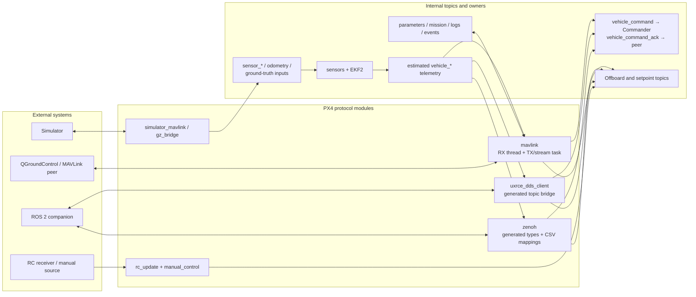
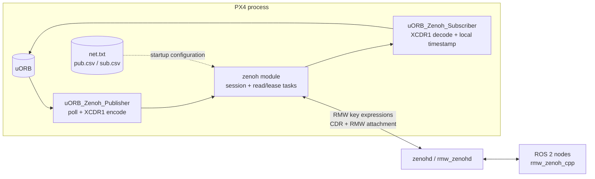
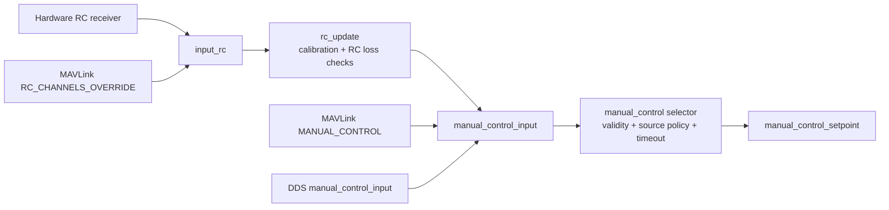

# 10 · Communication and ROS 2

**Previous: [09 · Missions, Navigation, and Autonomy](09-missions-navigation-and-autonomy.md)** · **[Index](../README.md)** · Next: [11 · Parameters, Storage, and Logging](11-parameters-storage-and-logging.md)

---

PX4 uses uORB as the internal integration point, but it does not have one universal external-message adapter:

- **MAVLink** performs protocol-specific validation, coordinate/unit conversion, targeting, acknowledgements, stream scheduling, and link-budget management.
- **uXRCE-DDS** provides a generated, mostly direct serialization bridge between selected ROS 2 topics/services and uORB. Semantic validation remains with publishers and consumers.
- **Zenoh** provides a separate, configurable uORB/CDR pub/sub bridge for ROS 2 `rmw_zenoh`, with generated type support and persistent topic mappings.
- **RC input** has separate hardware, MAVLink override, and MAVLink manual-control paths that converge at different stages.

Choosing the wrong bridge changes the contract, not just the transport.

## 1. Communication overview



## 2. MAVLink execution model

Each MAVLink instance has two main execution sides:

1. **Receiver thread:** polls UART/UDP, parses frames, validates signatures/targets, dispatches handlers, and drives mission/parameter/FTP/log/timesync receive state machines (`src/modules/mavlink/mavlink_receiver.cpp:3922-4218`).
2. **Main task:** updates parameters, schedules streams, handles shell output, ULog/events, forwarding, link statistics, and `telemetry_status` (`mavlink_main.cpp:2847-3008`).

At startup, non-Iridium instances configure essential streams such as `HEARTBEAT`, `STATUSTEXT`, and `COMMAND_LONG`, then apply mode-specific defaults (`mavlink_main.cpp:2766-2782`).

## 3. Outbound MAVLink streams

A stream is a `MavlinkStream` subclass with uORB subscriptions and a `send()` method. The registry is in `mavlink_messages.cpp:548-584`.

`MavlinkStream::update()` (`mavlink_stream.cpp:56-130`):

- calls `update_data()` so high-rate collection can be independent of output rate;
- sends immediately on first use;
- applies stream interval and link rate multiplier;
- supports interval zero for manual-only sends;
- supports negative interval for unlimited rate;
- advances average schedule without bursting after long delays.

Configured rates map as follows (`mavlink_main.cpp:1420-1471`):

- `rate > 0`: interval = `1e6 / rate` microseconds;
- `rate < 0`: unlimited;
- `rate = 0`: disabled/removed.

The TX loop computes a rate multiplier from configured data rate, constant/variable stream estimates, ULog streaming, bulk transfers, and radio feedback (`mavlink_main.cpp:1587-1684`). Radio `txbuf` and heartbeat/link statistics also influence throttling and telemetry status.

The generic send path checks free TX space, writes UART/UDP, updates byte/error counters, and serializes channel access (`mavlink_main.cpp:908-1007`).

```mermaid
sequenceDiagram
    autonumber
    participant P as Internal producer
    participant O as uORB
    participant S as MavlinkStream subclass
    participant M as MAVLink main task
    participant L as UART / UDP radio

    P->>O: Publish vehicle/state message
    M->>S: update(t) at main-loop opportunity
    S->>S: update_data()
    S->>O: Copy updated/latest topic data
    M->>M: Check interval + link rate multiplier
    alt Stream due and TX space available
        S->>L: send() serializes MAVLink frame
        L-->>GCS: External telemetry
    else Not due or no capacity
        M->>M: Defer; retain scheduling state
    end
```

Examples:

- `RC_CHANNELS` reads raw `input_rc`, not calibrated `rc_channels` (`streams/RC_CHANNELS.hpp:58-95`).
- `MANUAL_CONTROL` reads selected `manual_control_setpoint` (`streams/MANUAL_CONTROL.hpp:60-128`).
- `ATTITUDE_TARGET` combines attitude and rate setpoints (`streams/ATTITUDE_TARGET.hpp:59-102`).
- `STATUSTEXT` drains `mavlink_log`, drops stale messages, and splits long text (`streams/STATUSTEXT.hpp:65-127`).

## 4. Inbound command and acknowledgement

The central MAVLink dispatcher handles direct message types and then mission, parameter, FTP, log, timesync, and parent handlers (`mavlink_receiver.cpp:146-473`).

For `COMMAND_LONG` or `COMMAND_INT` (`mavlink_receiver.cpp:553-939`):

1. decode and create `vehicle_command_s`;
2. set local timestamp, source/target, and `from_external=true`;
3. convert `COMMAND_INT` coordinates/scales;
4. filter targets and validate parameters;
5. handle special commands locally or publish `vehicle_command`.

Commander consumes matching commands, executes the command-specific action, and publishes `vehicle_command_ack` to the original source (`src/modules/commander/Commander.cpp:864-929`, `:2120-2137`, `:2850-2888`). MAVLink serializes suitable acknowledgements as `COMMAND_ACK` (`mavlink_main.cpp:3233-3260`).

`SET_MODE` is translated into `VEHICLE_CMD_DO_SET_MODE`; it is not a separate Commander state machine.

## 5. Inbound Offboard setpoints

For `SET_POSITION_TARGET_LOCAL_NED` (`mavlink_receiver.cpp:1223-1351`):

1. apply target and forwarding checks;
2. interpret `type_mask` and fill unsupported fields with NaN;
3. rotate body-frame velocity/acceleration when needed;
4. derive and publish `offboard_control_mode` for liveness;
5. publish `trajectory_setpoint` only when `vehicle_status.accepts_offboard_setpoints` is true.

Global targets are projected into local NED with altitude-frame handling. Attitude/body-rate targets similarly publish Offboard liveness and forward setpoints only under the appropriate state (`mavlink_receiver.cpp:1859-1958`).

The transport does not make an old setpoint valid forever. Commander separately checks recent `offboard_control_mode`, supported control bits, and estimator requirements.

## 6. MAVLink shell, FTP, and log transfer

### Shell

A targeted `SERIAL_CONTROL` shell request starts or reuses one shell per MAVLink instance. Input goes through a pipe to an NSH/PXH task; the main MAVLink task drains output into replies (`mavlink_receiver.cpp:2117-2184`, `mavlink_shell.cpp:79-240`).

### FTP

`mavlink_ftp.cpp:219-445` dispatches list/open/read/burst/write/remove/rename/CRC operations. Important boundaries:

- one session; opening another closes the previous one;
- sessions time out after inactivity;
- burst downloads are paced against link capacity;
- `PX4_ROOTFSDIR` roots access and `..` components are rejected;
- writes must remain under `PX4_STORAGEDIR` (`mavlink_ftp.cpp:1339-1384`);
- `@PARAM/param.pck` is a virtual parameter file, not a normal filesystem object.

### Three different ULog-related paths

1. **Live ULog streaming:** logger emits `ulog_stream`; MAVLink sends `LOGGING_DATA` / `LOGGING_DATA_ACKED` with retransmission handling (`mavlink_ulog.cpp:82-263`).
2. **Stored-log protocol:** `LOG_REQUEST_LIST`, `LOG_REQUEST_DATA`, `LOG_REQUEST_END`, and erase operations (`mavlink_log_handler.cpp:77-410`).
3. **FTP download:** ordinary/burst file transfer of a log file.

They share log data but not the same state machine.

## 7. uXRCE-DDS bridge

### Manifest-driven topic allowlist

`src/modules/uxrce_dds_client/dds_topics.yaml:6-250` declares:

- `publications`: internal uORB → `/fmu/out/*`;
- `subscriptions`: ROS 2 `/fmu/in/*` → internal uORB;
- `subscriptions_multi`: inbound multi-instance routing.

Examples include outbound attitude/status/command acknowledgements and inbound Offboard, trajectory, attitude/rate/thrust/torque setpoints, and vehicle commands. Adding a message schema alone does not expose it through this client; the manifest and generated bridge must include it.

`generate_dds_topics.py:88-168` maps PX4 message names to uORB structs, DDS types, includes, topic names, and optional rate limits. `dds_topics.h.em` generates the actual conversion callbacks and output loops.

DDS topic names use `rt/[namespace/]fmu/...`; nonzero message versions append `_vN` (`utilities.hpp:26-50`). Generated uCDR serializers come from the same PX4 message definitions.

### Session and QoS

Client setup (`uxrce_dds_client.cpp:220-415`):

1. ping agent and create XRCE session;
2. create reliable setup streams and best-effort data streams;
3. synchronize timestamps;
4. create data writers/readers;
5. create reliable `VehicleCommand` replier;
6. request inbound data.

Topic writers/readers use the configured best-effort/keep-last policies, while the command service uses reliable/persistent behavior (`utilities.hpp:52-160`, `srv_base.cpp:87-149`).

### Inbound ROS 2 → uORB

Generated callbacks select the reader, deserialize CDR into the corresponding PX4 struct, and publish it. Multi-instance and `route_field` cases demultiplex according to the manifest (`dds_topics.h.em:234-284`).

`vehicle_command` has two paths:

- ordinary `/fmu/in/vehicle_command` topic bridge;
- reliable `VehicleCommand` service, which publishes the command and waits for a matching later `vehicle_command_ack` before replying (`vehicle_command_srv.cpp:38-90`).

### Outbound uORB → ROS 2

The main loop polls output subscriptions and transport activity (`uxrce_dds_client.cpp:656-827`). The generated bridge copies updated uORB data, serializes CDR, and flushes best-effort streams (`dds_topics.h.em:134-203`).

Default polling is 4 ms. Rate-limited topics forward the latest sample per wake-up; unlimited topics can drain up to the uORB queue depth.

### Timestamps and semantics

Generated serializers adjust only fields named exactly `timestamp` or `timestamp_sample` using the session time offset (`Tools/msg/templates/ucdr/msg.h.em:127-175`). Zero inbound timestamps are replaced with local time; nonzero values are offset/clamped.

Otherwise this is a direct field bridge. It does not add MAVLink-style coordinate conversion, NaN mask construction, source stamping, target validation, or Offboard health logic. ROS 2 publishers must supply correct NED/FRD frames, units, validity, source fields, and timestamps.

## 8. Zenoh bridge for ROS 2

`src/modules/zenoh/` is a second ROS 2 communication path, separate from `uxrce_dds_client`. It uses Zenoh-Pico to exchange CDR payloads with `zenohd`/`rmw_zenohd`, and ROS 2 nodes use `rmw_zenoh_cpp`. This path does not require a Micro-XRCE-DDS agent.

The upstream page marks the integration experimental and recommends an isolated, dedicated network. The router must not republish PX4 traffic onto other reachable networks (`docs/en/middleware/zenoh.md:3-39`).

### Build-time type support and runtime mappings

Zenoh has three related generation products:

1. `Kconfig.topics` is generated before Kconfig parsing and supplies `ZENOH_PUBSUB_*` options for message datatypes (`cmake/kconfig.cmake:23-54`).
2. `uorb_pubsub_factory.hpp` binds selected uORB types to CycloneDDS CDR descriptors, type names, and RIHS01 type hashes (`msg/CMakeLists.txt:606-630`, `Tools/zenoh/templates/zenoh/uorb_pubsub_factory.hpp.em:75-214`).
3. `default_topics.c` converts Zenoh's own `src/modules/zenoh/dds_topics.yaml` into initial publisher/subscriber CSV mappings (`src/modules/zenoh/CMakeLists.txt:89-100`).

The Kconfig selection controls which types are compiled into the factory. The YAML/CSV mappings control which endpoints are actually declared at runtime. Zenoh reuses the uXRCE manifest parser, but it does **not** use uXRCE's YAML file or generated bridge header.

### Runtime data path



Outbound, the module polls configured uORB subscriptions. `uORB_Zenoh_Publisher::update()` copies the message, prefixes the four-byte ROS 2 CDR encapsulation, serializes XCDR1 through the generated descriptor, and calls `z_publisher_put` (`src/modules/zenoh/publishers/uorb_publisher.hpp:51-98`, `publishers/zenoh_publisher.cpp:62-108`). Publications can include RMW sequence/time/GID attachments.

Inbound, the Zenoh read task invokes a callback that deserializes CDR and publishes to uORB. It overwrites the leading message timestamp with current HRT time (`src/modules/zenoh/subscribers/zenoh_subscriber.cpp:44-85`, `subscribers/uorb_subscriber.hpp:75-134`). Unlike uXRCE-DDS, this path has no session time-offset synchronization.

### Key expressions and ROS 2 identity

Normal keys have this shape (`src/modules/zenoh/zenoh.cpp:118-151`):

```text
<ZENOH_DOMAIN_ID><ROS_topic>/px4_msgs::msg::dds_::<Type>_/RIHS01_<64 hex digits>
```

Optional node/publisher/subscriber liveliness tokens support ROS 2 graph construction (`zenoh.cpp:153-220`). Default RIHS01 keys target ROS 2 Jazzy and later; Humble and earlier require disabling type-hash keys, which is not compatible with Jazzy+ (`docs/en/middleware/zenoh.md:41-61`). The liveliness generator is explicitly approximate rather than fully `rmw_zenoh_cpp`-compliant, so graph behavior—especially with a nonzero domain—needs testing.

### Configuration and startup

Persistent files are created below `CONFIG_BOARD_ROOT_PATH/zenoh` when missing (`src/modules/zenoh/zenoh_config.hpp:51-70`):

| File | Contents |
|---|---|
| `net.txt` | Zenoh mode and connect/peer locator |
| `pub.csv` | Publisher key expression, uORB type, instance, optional publisher options |
| `sub.csv` | Subscriber key expression, uORB type, instance |

The CLI can inspect and modify these mappings. Files are read during setup, so changes require a module restart/reboot (`zenoh_config.cpp:779-847`). `ZENOH_ENABLE` defaults to 0 and gates startup; global publisher reliability/congestion/express/priority settings are also reboot-required (`module.yaml:7-17`, `zenoh_params.yaml:5-60`).

NuttX starts Zenoh after generated serial setup when enabled (`ROMFS/px4fmu_common/init.d/rcS:599-611`). POSIX starts it independently of uXRCE-DDS (`ROMFS/px4fmu_common/init.d-posix/rcS:297-333`). Enabling Zenoh does **not** automatically disable uXRCE-DDS; board variants determine which bridges are compiled, and startup has separate gates.

Some board defaults compile Zenoh, while standard SITL and FMUv6X defaults provide separate `zenoh.px4board` variants. Regardless of compile-time inclusion, `ZENOH_ENABLE=0` means it does not start by default.

### Zenoh versus uXRCE-DDS

| Aspect | Zenoh | uXRCE-DDS |
|---|---|---|
| External path | Zenoh-Pico → `zenohd` → ROS 2 `rmw_zenoh` | Micro-XRCE-DDS client → XRCE Agent → DDS/ROS 2 RMW |
| Serialization | CycloneDDS descriptors, XCDR1 + ROS encapsulation | Generated Micro-CDR serializers |
| Topic configuration | Kconfig type factory + generated/persistent CSV mappings | Generated static bridge from its separate `dds_topics.yaml` |
| ROS identity | RMW key expressions, RIHS01, optional liveliness/attachments | DDS readers/writers and `rt/...` names with version suffixes |
| Time handling | Inbound timestamp replaced with local HRT; no session offset sync | Session timestamp synchronization and offset conversion |
| Command service | Pub/sub bridge, no equivalent reliable VehicleCommand service | Reliable VehicleCommand request/reply service |
| Startup gate | `ZENOH_ENABLE` | Target/serial/POSIX startup configuration |

## 9. RC and manual-control paths



- `RC_CHANNELS_OVERRIDE` becomes `input_rc` and therefore passes through RC calibration/failsafe processing (`mavlink_receiver.cpp:2338-2424`).
- `MANUAL_CONTROL` becomes `manual_control_input` directly and bypasses RC calibration (`:2427-2478`).
- `rc_update` normalizes channels, publishes diagnostic `rc_channels`, and emits manual input/switches when stable (`rc_update.cpp:370-548`, `:697-720`).
- `ManualControlSelector` applies validity, `COM_RC_LOSS_T`, and `COM_RC_IN_MODE` source policy (`ManualControlSelector.cpp:36-135`).

A DDS manual publisher must supply meaningful `valid`, `data_source`, and timestamp fields; unlike MAVLink, the bridge does not stamp them for semantic correctness.

## 10. Events and time synchronization

### Events

`src/lib/events/events.cpp:41-68` publishes structured, sequenced events. Logger and MAVLink consume them independently with their own level filtering. MAVLink event handling provides bounded buffering, current-sequence messages, and retransmission requests (`mavlink_events.cpp:43-242`).

Events are not interchangeable with free-form `mavlink_log` / `STATUSTEXT` messages.

### Time

Monotonic HRT and wall-clock RTC are different:

- `time_persistor` periodically saves and restores RTC (`TimePersistor.cpp:52-82`, `:132-175`);
- MAVLink timesync handles offset/round-trip estimation (`mavlink_timesync.cpp:54-118`);
- uXRCE-DDS maintains a session offset for generated timestamp conversion;
- Zenoh does not synchronize session time; its inbound bridge replaces the leading timestamp with local HRT time;
- GNSS/PPS can discipline sensor timestamp handling as described in [06](06-sensors-and-state-estimation.md).

Do not replace sample monotonic timestamps with wall-clock time.

## 11. Communication contributor pitfalls

1. **Choose the correct entry stage.** RC override, manual control, trajectory, attitude, rate, and torque are different contracts.
2. **A MAVLink stream is not automatically link-budget-free.** Set appropriate rates and `const_rate` behavior and consider radio feedback.
3. **Offboard liveness and setpoint validity are separate.** Maintain `offboard_control_mode` and valid estimates.
4. **DDS exposure requires manifest changes.** A `.msg` file alone is not enough.
5. **DDS does not add MAVLink semantics.** Supply source, validity, units, frames, and timestamps explicitly.
6. **Zenoh has separate Kconfig type support and CSV/YAML mappings.** Changing uXRCE's manifest does not configure it.
7. **Enabling Zenoh does not disable uXRCE-DDS.** Check both build inclusion and independent startup gates.
8. **Acknowledgements have source/target rules.** Do not publish an unrelated ack and expect correlation.
9. **Live log streaming, stored-log download, and FTP are separate.** Use the intended protocol state machine.
10. **Do not put high-rate stream sends in the receiver path.** Preserve the RX/TX scheduling split.
11. **Mission upload ownership belongs to MAVLink mission management; execution belongs to Navigator.** Keep that boundary.
12. **Test low bandwidth and loss.** Correct operation at full USB/localhost bandwidth does not validate radio behavior.

---

**Previous: [09 · Missions, Navigation, and Autonomy](09-missions-navigation-and-autonomy.md)** · **[Index](../README.md)** · Next: [11 · Parameters, Storage, and Logging](11-parameters-storage-and-logging.md)
