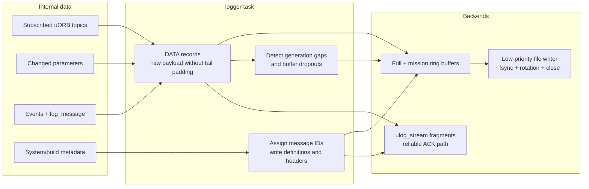

# 11 · Parameters, Storage, and Logging

**Previous: [10 · Communication and ROS 2](10-communication-and-ros2.md)** · **[Index](../README.md)** · Next: [12 · Simulation, Testing, and Replay](12-simulation-testing-and-replay.md)

---

PX4 has several persistence systems with deliberately different data models:

| System | Data model | Main users |
|---|---|---|
| Parameters | Named typed values with layered defaults | Almost every module; GCS and startup scripts |
| Dataman | Fixed-size indexed records and two-bank mission-related state | Missions, geofence, rally points, mission state |
| ULog/logger | Time-series message streams plus definitions, parameters, events, and metadata | Flight analysis, debugging, replay |
| ROMFS/storage scripts | Build-time defaults and user startup customization | Boot and vehicle configuration |
| Time persistor | Saved wall-clock RTC | Restoring time across reboot |

They are not interchangeable. A parameter change is not a Dataman transaction, and a MAVLink telemetry stream is not the flight log.

## 1. Parameter architecture

Parameters are resolved through three layers (`src/lib/parameters/parameters.cpp:104-121`):

```text
user_config (DynamicSparseLayer)
    → runtime_defaults (DynamicSparseLayer)
        → firmware_defaults (ConstLayer)
```

- **Firmware defaults** come from generated definitions.
- **Runtime defaults** are airframe/setup-specific defaults.
- **User config** stores explicit current-value overrides.

`param_get()` resolves down that chain (`parameters.cpp:301-333`). Reset removes the user override, exposing the runtime default again (`:640-680`).

Generated parameter metadata includes sorted definitions, types, volatile/read-only flags, and defaults (`src/lib/parameters/templates/px4_parameters.hpp.jinja:8-56`). Module YAML and board configuration feed that generation as described in [02](02-build-system-and-configuration.md).

### Used versus merely defined

`param_find()` marks a parameter active/used; `param_find_no_notification()` does not (`src/lib/parameters/param.h:91-107`, `:282-288`). Ground-station parameter enumeration normally operates on used parameters rather than every possible definition in the source tree.

### C++ cached parameters

Modules commonly inherit `ModuleParams` and declare typed `Param<T>` members. These objects cache values. After a `parameter_update`, the module must call `updateParams()` to refresh them (`platforms/common/include/px4_platform_common/module_params.h:69-86`).

## 2. Parameter set and notification sequence

A normal `param_set()` (`parameters.cpp:418-533`):

1. validates handle, value, type, and read-only state;
2. detects actual change using integer comparison or float epsilon;
3. stores the override in `user_config`;
4. marks the value unsaved unless loading from persistence;
5. requests autosave where appropriate;
6. propagates to primary/remote peers if configured;
7. publishes `parameter_update` if notification is enabled and the value changed.

`parameter_update` is a **summary notification**, not the changed name/value (`msg/ParameterUpdate.msg:1-14`). It contains counters and active/changed/default counts. Each module reacts by refreshing its own cached parameters.

`param_set_no_notification()` still changes storage and schedules autosave; it only suppresses the uORB notice. `param_set_no_remote_update()` controls peer propagation separately.

```mermaid
sequenceDiagram
    autonumber
    participant U as User / GCS / script
    participant P as Parameter store
    participant A as Autosave worker
    participant O as parameter_update topic
    participant M as Module with ModuleParams
    participant S as File or flash backend

    U->>P: param_set(name, value)
    P->>P: Validate + compare + store user override
    P->>A: Request coalesced autosave
    P->>O: Publish summary notification
    O-->>M: Wake/update notification
    M->>M: updateParams() refreshes cached Param objects
    A->>A: Wait ≥300 ms; rate-limit saves
    alt Flash backend while armed
        A->>A: Defer to avoid CPU-stalling erase/program
    else Save permitted
        A->>S: Save overrides / deltas and verify
    end
```

## 3. Autosave and concurrency

Autosave (`src/lib/parameters/autosave.cpp:45-130`):

- coalesces changes for at least 300 ms;
- limits saves to one per two seconds;
- retries failures up to three times;
- defers flash saves while armed because erase/program can stall the CPU.

The delay also gives logger time to observe changed parameters while they remain marked unsaved.

Separate unsaved and save-in-progress bitsets ensure that a parameter changing during a save is marked again for the next save. Failed saves restore unsaved state (`parameters.cpp:104-111`, `:849-902`).

`AtomicTransaction` uses a recursive mutex on POSIX and interrupt exclusion on NuttX (`atomic_transaction.h:45-91`). File saves are additionally serialized by a file mutex.

## 4. File/BSON backend

When a default parameter filename is configured (`parameters.cpp:825-933`):

1. open/truncate the file;
2. export non-default user overrides as BSON;
3. close, reopen, and verify;
4. retry up to three attempts if needed;
5. optionally write and verify a backup.

Export skips values equal to the active runtime default (`:1120-1210`). Load resets values and imports; import merges into the current set. Unknown names are ignored and translation hooks can rewrite old definitions (`:1220-1286`, `:1426-1448`).

Typical paths:

- Kconfig default on embedded systems: `/fs/mtd_params` (`Kconfig:230-248`);
- POSIX startup: `fs/parameters.bson` (`ROMFS/px4fmu_common/init.d-posix/rcS:66-73`).

NuttX startup uses `param load-or-init`, distinguishing blank storage from corruption and seeding from backup/defaults (`ROMFS/px4fmu_common/init.d/rcS:198-243`, `src/systemcmds/param/param.cpp:550-653`).

## 5. Flash backend

With `FLASH_BASED_PARAMS` and a null default filename, PX4 uses flash (`src/lib/parameters/flashparams/flashparams.cpp`).

The current format is:

```text
full BSON snapshot → ordered BSON deltas → compaction when needed
```

Deltas contain only unsaved entries. Reset/default entries become BSON null tombstones. Replay applies records in order. Sector pressure, unreadable log state, legacy format, or stale records can trigger compaction (`:70-177`, `:331-355`, `:473-595`). Records carry token, size, and CRC (`flashfs.c:753-804`).

The backend distinguishes erased/blank storage from nonblank but unreadable storage instead of silently treating all corruption as empty.

## 6. External parameter interfaces

### MAVLink `PARAM_SET`

MAVLink validates target/name/type/read-only state, calls `param_set()`, reads the current value, and sends `PARAM_VALUE` (`src/modules/mavlink/mavlink_parameters.cpp:228-280`). On update, it scans used parameters and sends unsaved changes with link-aware throttling (`:533-581`).

### Packed parameter file over FTP

`@PARAM/param.pck` supports parameter download/upload. Upload applies entries with `param_set_no_notification()` and emits one notification after the complete applied file closes (`mavlink_ftp_param.cpp:369-439`, `:632-690`).

This is **not transactional across the file**: earlier entries can remain applied if a later chunk fails.

## 7. Logger configuration and topic selection

Startup maps parameters to logger behavior (`ROMFS/px4fmu_common/init.d/rc.logging:12-57`):

- `SDLOG_MODE`: armed, boot-to-disarm, boot-to-shutdown, AUX1, or first-arm-to-shutdown;
- `SDLOG_BACKEND`: file, MAVLink, or both; zero disables logger startup;
- `SDLOG_PROFILE`: additive topic-profile bitmask;
- `SDLOG_MISSION`: reduced mission log;
- `SDLOG_MAX_SIZE`, `SDLOG_ROTATE`, `SDLOG_DIRS_MAX`: rotation and cleanup;
- `SDLOG_BOOT_BAT`: battery condition for boot logging.

Topic selection is in `src/modules/logger/logged_topics.cpp:46-650`. Profiles are additive; if several add a topic, the later interval wins.

A custom file can be placed at:

```text
PX4_STORAGEDIR/etc/logging/logger_topics.txt
```

Lines use `<topic> [interval_ms] [instance]` (`logged_topics.cpp:438-490`). Optional topics are included only if advertised; nonexistent optional instance zero can be recorded in metadata.

Mission topics are inserted first so full and mission logs share subscription IDs (`logger.cpp:505-575`).

## 8. Logger runtime pipeline



When a file log starts, logger writes ULog header/flag bits, version/system information, message formats, parameters/defaults for full logs, performance and console metadata, event metadata, excluded topics, and add-logged-message records (`logger.cpp:1479-1566`, `:2141-2251`). Wire structures are in `logger/messages.h:38-297`.

During full logging (`logger.cpp:709-947`):

1. write currently unsaved used parameters after update;
2. lock writer buffers;
3. write a DATA record for each updated subscription using internal message ID and payload without tail padding;
4. duplicate selected records to the mission backend at mission intervals;
5. write events, `log_message`, and sync records;
6. update dropout statistics and `logger_status`;
7. notify writers and rotate if needed.

Full-rate subscriptions detect uORB generation gaps. Topics advertised later can emit new add-logged-message records (`logger.cpp:455-489`).

## 9. File writer and dropouts

The file backend (`log_writer_file.cpp:63-80`, `:284-565`) has:

- a configurable full-log ring buffer;
- a smaller mission ring buffer;
- a low-priority writer thread;
- mission-first draining;
- periodic `fsync`;
- drain-and-close on stop.

If a normal write cannot fit, logger begins a dropout interval. The next successful write inserts a ULog dropout record (`logger.cpp:1269-1295`). Reliable header/definition writes instead block and split until space exists.

Dropouts are therefore explicit log data, not just missing bytes that analysis tools must guess about.

## 10. MAVLink logging backend

MAVLink logging starts independently through `VEHICLE_CMD_LOGGING_START`, not automatically with file-log arming state (`logger.cpp:1239-1266`). Logger emits identical ULog bytes into `ulog_stream` fragments. Reliable fragments request acknowledgement and can block/retry (`log_writer_mavlink.cpp:88-185`).

MAVLink converts those fragments into `LOGGING_DATA` or `LOGGING_DATA_ACKED`, handles retransmission, and returns `LOGGING_ACK` as `ulog_stream_ack` (`mavlink_ulog.cpp:82-263`). This is live streaming, distinct from downloading a stored log or using FTP.

## 11. Dataman persistence in brief

Dataman provides fixed-size indexed records and two-bank state for missions, geofence, and safe/rally points (`src/modules/dataman/dataman.h:45-127`). Backends are a default file at `PX4_STORAGEDIR/dataman` or explicitly nonpersistent RAM (`dataman.cpp:158-169`, `:254-330`).

Requests use `dataman_request`; responses match client, operation, item, and index (`dataman.cpp:687-823`). Clients can be synchronous with retry or asynchronous with regular `update()` calls (`src/lib/dataman_client/DatamanClient.cpp:86-149`, `:278-488`). Atomicity is per item only.

Mission ownership and caching are covered in [09](09-missions-navigation-and-autonomy.md).

## 12. Storage layout and useful distinctions

| Data | Typical location / owner |
|---|---|
| Full ULog files | `PX4_STORAGEDIR/log` |
| Mission ULog files | `CONFIG_BOARD_ROOT_PATH/mission_log` |
| Dataman file | `PX4_STORAGEDIR/dataman` |
| POSIX parameters | `fs/parameters.bson` under the runtime root |
| Custom logger topics | `PX4_STORAGEDIR/etc/logging/logger_topics.txt` |
| Early user startup | Storage `etc/config.txt` |
| Late user startup | Storage `etc/extras.txt` |
| Replacement NuttX autostart | Storage `etc/rc.txt` |

`PX4_STORAGEDIR`, `PX4_ROOTFSDIR`, and `CONFIG_BOARD_ROOT_PATH` are configuration concepts, not one universal hardcoded host path. Inspect the selected target's startup configuration.

## 13. Parameter/logging pitfalls

1. **A `parameter_update` does not contain the new value.** Refresh cached parameters.
2. **Changing a parameter does not mean it is already persisted.** Autosave is delayed/rate-limited and may be deferred while armed.
3. **Runtime default and user override are different.** Reset exposes the default rather than necessarily writing zero.
4. **Packed parameter upload is not a multi-entry transaction.** Partial application is possible on failure.
5. **Logger does not subscribe to MAVLink telemetry streams.** It records internal topics independently.
6. **Adding a topic to telemetry does not add it to ULog.** Update logger profiles/custom topic configuration separately.
7. **File and MAVLink logging have independent start conditions.** Check both backend and mode.
8. **Buffer overflow becomes a dropout.** Inspect `logger_status` and dropout records before trusting gaps as real sensor loss.
9. **Dataman is not a general document database.** Records are fixed-size/indexed and atomicity is per item.
10. **Do not perform unbounded storage work in real-time paths.** Use existing worker, cache, and disarmed-save patterns.
11. **Generated parameter declarations should not be edited.** Change the owning YAML/source metadata and rebuild.
12. **Volatile/read-only flags matter.** Respect their persistence and update semantics rather than bypassing the public API.

---

**Previous: [10 · Communication and ROS 2](10-communication-and-ros2.md)** · **[Index](../README.md)** · Next: [12 · Simulation, Testing, and Replay](12-simulation-testing-and-replay.md)
