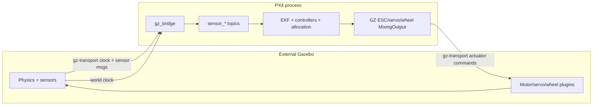
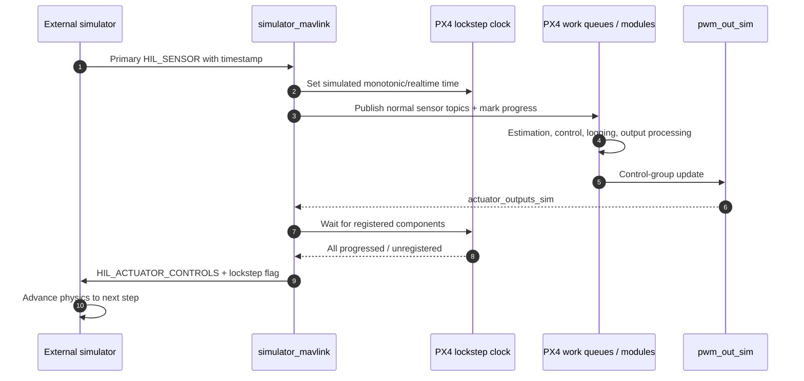
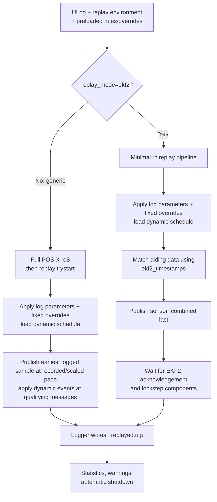

# 12 · Simulation, Testing, and Replay

**Previous: [11 · Parameters, Storage, and Logging](11-parameters-storage-and-logging.md)** · **[Index](../README.md)** · Next: [13 · Contributor Guide](13-contributor-guide.md)

---

Simulation works because PX4's architecture is message-driven. Simulator-specific modules publish the same sensor topics as hardware drivers and consume the same output boundaries as physical output drivers. Estimators and controllers do not need a special “simulated flight” algorithm.

The main complexity is the **transport and timing contract**, which differs between modern Gazebo, MAVLink simulators, SIH, and HITL.

## 1. Simulation modes

| Mode | Physics/transport | Sensor ingress | Actuator return | Timing |
|---|---|---|---|---|
| Modern Gazebo (`gz`) | External Gazebo; `gz-transport` | `gz_bridge` → normal `sensor_*` and other topics | Gazebo-specific `MixingOutput` interfaces → Gazebo actuator topics | Gazebo clock drives PX4 clocks; no same explicit component barrier as MAVLink/SIH in this revision |
| External MAVLink simulator | Gazebo Classic, JSBSim, FlightGear, X-Plane, compatible peers | `simulator_mavlink` decodes HIL/odometry/flow/etc. | `pwm_out_sim` → `actuator_outputs_sim` → `HIL_ACTUATOR_CONTROLS` | Optional explicit lockstep sensor/component barrier |
| SIH as SITL | Dynamics inside PX4 process | SIH + auxiliary sensor simulators → normal topics | SIH consumes `actuator_outputs_sim` | Virtual time and explicit output wait in SITL |
| HITL on NuttX | External simulator over MAVLink | Normal MAVLink HIL receive path | `pwm_out_sim -m hil` → HIL actuator stream | Real-time NuttX, not POSIX lockstep |
| SIH on NuttX | Dynamics inside flight firmware | Same internal SIH topics | Same internal SIH consumption | Periodic HRT loop |

Gazebo and SIH are the core-supported choices. Gazebo Classic and several other simulators are community-supported; see upstream simulator documentation for current support status.

## 2. SITL build and startup

Useful SITL configurations include:

- `px4_sitl_default`: full common simulation support;
- `px4_sitl_sih`: removes modern Gazebo dependencies;
- `px4_sitl_nolockstep`: disables lockstep;
- `px4_sitl_test`: test configuration with lockstep disabled;
- `px4_sitl_replay`: replay publisher rules with lockstep forced in that config.

Ordinary SITL enables lockstep by default (`boards/px4/sitl/sitl.cmake:1-13`). Kconfig can explicitly select `BOARD_LOCKSTEP` or `BOARD_NOLOCKSTEP`.

The main startup script is `ROMFS/px4fmu_common/init.d-posix/rcS`, not `posix-configs/`. It:

1. maps `PX4_SIM_MODEL` to an airframe/autostart ID;
2. applies simulated calibration IDs and defaults;
3. sources the selected `init.d-posix/airframes` file;
4. starts the simulator interface through `px4-rc.simulator`;
5. starts normal sensors, Commander, `pwm_out_sim`, vehicle controllers, communication, estimators, and logging.

`px4-rc.simulator` selects SIH, RotorPy, modern Gazebo, X-Plane, or the MAVLink simulator fallback (`init.d-posix/px4-rc.simulator:13-33`).

`posix-configs/` instead contains legacy in-process SITL test scripts and real Linux-board configurations. **POSIX does not imply simulation.**

## 3. The shared sensor boundary

Simulator-specific code stops at standard publication helpers such as `PX4Accelerometer`, `PX4Gyroscope`, `PX4Magnetometer`, `PX4Barometer`, and `PX4Rangefinder`. These publish normal messages with device IDs, timestamps, units, and error/failure-injection support.

Downstream, `VehicleIMU`, GNSS processing, and EKF2 consume the same topics as they do with hardware (`src/modules/sensors/vehicle_imu/VehicleIMU.cpp:50-55`, `src/modules/ekf2/EKF2.hpp:427-496`).

Ground-truth topics are separate:

- `vehicle_attitude_groundtruth`
- `vehicle_angular_velocity_groundtruth`
- `vehicle_local_position_groundtruth`
- `vehicle_global_position_groundtruth`

They support analysis, logging, visualization, and auxiliary sensor generation. They do not silently replace the estimator's noisy measurement inputs.

## 4. Modern Gazebo

### Startup and process topology

`init.d-posix/px4-rc.gzsim` loads generated resource/plugin paths, requires a supported `gz sim`, starts or attaches to a world, spawns/attaches the model, and starts `gz_bridge` (`px4-rc.gzsim:41-67`, `:114-158`, `:209-218`). `PX4_SIM_SPEED_FACTOR` adjusts the world's real-time factor (`:160-189`).

An airframe such as `4001_gz_x500` selects simulator/world, rotor configuration, and `SIM_GZ_EC_FUNC*`/min/max output mappings (`init.d-posix/airframes/4001_gz_x500:8-48`).

### Sensor path

`GZBridge` subscribes first to world clock/pose, then configured IMU, magnetometer, NavSat, pressure, lidar, airspeed, optical flow, and odometry topics (`src/modules/simulation/gz_bridge/GZBridge.cpp:65-140`). Waiting for nonzero clock avoids invalid initial estimator timestamps.

Conversions include:

- IMU FLU→FRD and publication through standard helpers (`:560-590`);
- GNSS reference/noise/fix metadata and multi-instance `sensor_gnss` (`:812-905`);
- magnetometer frame/unit conversion (`:484-524`);
- differential pressure and barometer (`:526-558`);
- optical flow (`:450-482`);
- odometry ENU/FLU→NED/FRD (`:683-745`);
- ground truth and lidar/obstacle topics (`:592-680`, `:907-1030`).

### Actuator path

Modern Gazebo does **not** use normalized `actuator_outputs_sim` for its physical commands. `GZBridge` creates separate ESC, servo, and wheel mixing interfaces (`GZBridge.cpp:142-158`):

- ESC: raw configured values → `gz.msgs.Actuators.velocity` → `/<model>/command/motor_speed` (`GZMixingInterfaceESC.cpp:37-107`);
- servo: configured values → radians → `/model/<model>/servo_N` (`GZMixingInterfaceServo.cpp:106-159`);
- wheel: shifted output values → motor-speed command (`GZMixingInterfaceWheel.cpp:63-99`).

These are not interchangeable with MAVLink `HIL_ACTUATOR_CONTROLS`. For example, x500 ESC output values use configured ranges such as 150/1000, not `[0,1]`.



## 5. External MAVLink simulators

`simulator_mavlink` dispatches HIL sensor, GPS, optical flow, odometry, vision, distance, RC, landing target, ground truth, and RPM messages (`SimulatorMavlink.cpp:316-379`).

Examples:

- `HIL_SENSOR` → accel/gyro/mag/baro/differential-pressure helpers (`:204-313`);
- `HIL_GPS` → multi-instance `sensor_gnss` (`:389-473`);
- `HIL_OPTICAL_FLOW` → `sensor_optical_flow` (`:1070-1113`);
- `RC_CHANNELS` → `input_rc` (`:1115-1150`);
- `ODOMETRY` → visual/mocap odometry (`:1040-1067`);
- `HIL_STATE_QUATERNION` → separate ground-truth topics (`:523-611`).

`pwm_out_sim` publishes `actuator_outputs_sim` after control-group updates (`src/modules/simulation/pwm_out_sim/PWMSim.cpp:63-99`). The simulator sending thread encodes `HIL_ACTUATOR_CONTROLS`; outputs remain zero while disarmed (`SimulatorMavlink.cpp:121-142`, `:1253-1264`).

## 6. SIH

SIH closes the dynamics loop inside PX4 (`src/modules/simulation/simulator_sih/sih.cpp:233-285`):

1. read actuator output;
2. generate forces/torques;
3. integrate equations of motion;
4. reconstruct noisy IMU signals;
5. optionally generate airspeed, distance, beacon, and ground-truth data.

Auxiliary simulators consume ground truth and produce realistic sensor streams:

- GNSS (`sensor_gps_sim`);
- barometer (`sensor_baro_sim`);
- magnetometer (`sensor_mag_sim`);
- differential pressure/airspeed (`sensor_airspeed_sim`);
- auxiliary global position (`sensor_agp_sim`);
- battery and system power.

SIH consumes `actuator_outputs_sim` directly and applies actuator response where configured (`sih.cpp:370-389`). In SITL it advances virtual time and waits for output; on NuttX it uses a periodic HRT loop (`:103-217`).

## 7. Lockstep and virtual time

With `ENABLE_LOCKSTEP_SCHEDULER`, `hrt_absolute_time()` follows `LockstepScheduler`, and sleeps/timed waits wait for simulated time (`platforms/posix/src/px4/common/drv_hrt.cpp:109-123`, `:496-537`).

Work queues register while busy and unregister when idle (`platforms/common/px4_work_queue/WorkQueue.cpp:135-151`, `:218-225`). Registered components must make progress before a waiting simulator continues.

### MAVLink lockstep sequence



Startup can wait for the first primary sensor message to initialize time. Control Allocation disables its independent backup schedule under lockstep so that backup does not interfere with the component barrier (`ControlAllocator.cpp:93-103`, `:307-310`).

### SIH lockstep

SIH advances virtual time, publishes sensors, marks progress, waits for other components and a fresh `actuator_outputs_sim`, then takes the next physics step (`sih.cpp:103-184`). Startup freewheels before the first output; an extreme wall-clock timeout can allow progress with a warning, which matters for reproducibility.

### Modern Gazebo nuance

`GZBridge::clockCallback` copies Gazebo simulation time to PX4 clocks (`GZBridge.cpp:432-448`). In this revision, it does not call the explicit `px4_lockstep_register_component`, `px4_lockstep_progress`, or `px4_lockstep_wait_for_components` functions used by the MAVLink/SIH paths.

Modern Gazebo therefore has clock synchronization, but source inspection does not show the same one-sensor-step-to-one-component-barrier contract. Do not claim deterministic one-physics-step-per-control-step behavior without a separate verification.

### Speed factor

`PX4_SIM_SPEED_FACTOR` changes wall-clock pacing, not the simulated physics timestep. Actual acceleration remains CPU/I/O-bound, and selected PX4 timeouts are adjusted in POSIX startup for faster simulated time (`init.d-posix/rcS:194-212`).

## 8. HITL and SIH on NuttX

With `SYS_HITL=1`, normal firmware runs on the flight board while external physics supplies HIL messages:

- real sensor startup is bypassed in HIL mode;
- normal MAVLink receive handlers decode HIL data only when HIL is enabled;
- `pwm_out_sim -m hil` replaces normal real PWM startup (`ROMFS/px4fmu_common/init.d/rcS:396-441`, `:538-562`);
- `actuator_outputs_sim` feeds the MAVLink HIL actuator stream.

This is real-time NuttX execution, not POSIX lockstep.

With `SYS_HITL=2`, SIH and auxiliary simulators run on the flight controller using HRT. Real actuator output is not automatically enabled; deliberately starting it requires hardware safety precautions.

## 9. Common build and simulation commands

Commands below are verified against source/build/test definitions, but were **not executed** while producing this documentation. Run from `PX4-Autopilot/` after toolchain setup:

```bash
# Build SITL
make px4_sitl_default
make px4_sitl_sih

# Modern Gazebo
make px4_sitl gz_x500
HEADLESS=1 make px4_sitl gz_x500
PX4_GZ_WORLD=windy make px4_sitl gz_x500
PX4_SIM_SPEED_FACTOR=2 make px4_sitl gz_x500

# SIH without Gazebo dependencies
make px4_sitl_sih sihsim_quadx
make px4_sitl_sih sihsim_airplane
make px4_sitl_sih sihsim_standard_vtol

# Gazebo Classic / other integrations where dependencies exist
make px4_sitl gazebo-classic
make px4_sitl jsbsim_rascal
make px4_sitl_nolockstep flightgear_rascal

# PX4 alone for an external MAVLink simulator
make px4_sitl none_iris

# Multiple SIH instances
./Tools/simulation/sitl_multiple_run.sh 3 sihsim_quadx px4_sitl_sih
```

Do not assume `DONT_RUN=1` applies to modern Gazebo; it is checked by Classic/JSBSim launch scripts, while modern Gazebo targets execute PX4 directly.

## 10. Unit, functional, and SITL tests

PX4 registers tests as:

- `unit-*`: minimal internal dependencies;
- `functional-*`: tests requiring uORB/parameters/system infrastructure;
- `sitl-*` / `posix_*`: full PX4 process tests using `posix-configs/SITL/init/test`.

Registration is in `cmake/px4_add_gtest.cmake:69-183`.

```bash
make tests
make tests TESTFILTER=unit
make tests TESTFILTER=functional
make tests TESTFILTER=sitl
make tests TESTFILTER=Attitude
make tests TESTFILTER=GZBridge
```

`make tests` builds `px4_sitl_test` and invokes CTest (`Makefile:457-468`, `test/CMakeLists.txt:11-28`). Test binaries are under `build/px4_sitl_test/`.

Functional tests can retain global uORB/parameter state. When debugging stateful behavior, run one test per invocation as recommended by upstream test documentation.

Additional host checks include coverage, sanitizers, fuzz tests, formatting, and static analysis. Use the same target/configuration as CI when reproducing a failure.

## 11. MAVSDK integration tests

Install the pinned test requirements from `Tools/setup/test-requirements.txt` in an isolated Python environment. Typical commands:

```bash
make px4_sitl_default

test/mavsdk_tests/mavsdk_test_runner.py \
  test/mavsdk_tests/configs/sih-sitl.json --speed-factor 10

test/mavsdk_tests/mavsdk_test_runner.py \
  test/mavsdk_tests/configs/sih-sitl.json \
  --speed-factor 10 --model quadx \
  --case 'test_multicopter_mission.py::test_square_mission_with_return'
```

Each case can start a fresh PX4 instance and configured simulator, then clear the runtime root filesystem except retained logs (`test/mavsdk_tests/integration_test_runner/process_helper.py:195-216`). Current CI uses SIH for the MAVSDK suite (`.github/workflows/sitl_tests.yml:61-100`).

`make tests_integration` wraps the SIH MAVSDK configuration (`Makefile:513-519`).

## 12. ROS 2 integration tests

The current path uses `px4_sitl_sih`, a separately built ROS 2 workspace, and the SIH configuration. `Tools/ros2/prepare_workspace.py` requires a new/empty workspace and immutable source pins, then replaces message definitions with those from the current PX4 checkout (`Tools/ros2/prepare_workspace.py:13-75`).

The test runner starts/restarts the XRCE agent to avoid stale discovery state (`test/ros_test_runner.py:52-62`, `:219-233`). Useful runner commands include:

```bash
test/ros_test_runner.py --list-cases

test/ros_test_runner.py --verbose --model quadx --force-color \
  --config-file test/ros_tests/config-sih.json \
  --build-dir build/px4_sitl_sih \
  --px4-ros2-interface-lib-build-dir /path/to/ros2_ws/build/px4_ros2_cpp \
  --log-dir logs/ros-sih

python3 -m unittest discover -s test -p 'test_ros_test_runner.py'
```

Use the ROS distribution and dependency commits pinned by upstream CI rather than mixing arbitrary interface versions.

## 13. Replay

Replay reads a ULog and republishes recorded messages through uORB. The same topic boundaries used by simulation allow logged input to replace live drivers. `src/modules/replay/` implements two materially different workflows:

| Aspect | Generic replay | `replay_mode=ekf2` |
|---|---|---|
| Startup | Full POSIX `rcS` airframe/module setup; `replay trystart` runs last | `rcS` immediately sources `rc.replay` and exits, starting only the EKF2/logger replay pipeline |
| Data selection | Finds usable logged subscriptions and publishes the earliest next sample across streams | Retains EKF2-relevant streams; `ekf2_timestamps` drives publication order, with an approximate IMU fallback |
| Timing | Recorded speed by default; shifts each top-level timestamp into a new replay timeline | Runs as fast as processing permits and preserves original timestamps for matching |
| Speed factor | Optional `PX4_SIM_SPEED_FACTOR`; zero disables sleeping | Forced to zero regardless of the generic setting |
| EKF2 | Started by normal startup | Started as one regular instance with `ekf2 start -r` |

Selection and startup are in `src/modules/replay/Replay.cpp:1224-1240`, `ROMFS/px4fmu_common/init.d-posix/rcS:20-26`, `:257-263`, and `:370-401`.

### Environment and commands

Both modes require `replay` to contain the absolute path of an existing readable ULog. Keep it exported for configuration/build and execution: the Makefile uses it to add the `_replay` build-directory suffix, while the executable uses it to open the log (`Makefile:123-130`, `:179-184`, `src/modules/replay/replay_main.cpp:38-49`).

```bash
# Generic full-system replay
export replay=/absolute/path/input.ulg
make px4_sitl_default
# Install publisher rules and optional overrides before execution.
make px4_sitl_default none_iris
unset replay

# EKF2-specific replay
export replay=/absolute/path/input.ulg
export replay_mode=ekf2
make px4_sitl none
unset replay replay_mode
```

The default build becomes `build/px4_sitl_default_replay`. Configuring with `replay` set compiles publisher rules and disables normal lockstep by default; the separate `px4_sitl_replay` board label instead forces lockstep (`boards/px4/sitl/sitl.cmake:2-13`, `boards/px4/sitl/replay.px4board:1-2`).

A new log is written under the replay rootfs with `_replayed` in the filename and the source path in metadata (`src/modules/logger/logger.cpp:1371-1399`, `:2244-2246`). Console output reports progress, dropouts, parameter warnings, synchronization issues, and a final published-message count before automatic shutdown.

### Log prerequisites

For **generic replay**, log every input required by the modules under test at the rate their consumers require. Each replayed message needs a valid 64-bit top-level `timestamp`; other timestamp fields must retain their relationship to it because generic replay shifts only the top-level field (`Replay.cpp:540-553`, `:972-1000`). Filesystem or mission state may also need separate setup.

For useful **EKF2 replay**:

- record from boot with `SDLOG_MODE=1`;
- use one EKF2 instance (`SENS_IMU_MODE=1`, `SENS_MAG_MODE=1`); multi-EKF replay is unsupported;
- avoid logging dropouts;
- include the estimator-replay logging profile, for example `SDLOG_PROFILE=3` to retain the default profile and add replay topics (`src/modules/logger/logged_topics.h:46-49`, `logged_topics.cpp:349-371`);
- include `sensor_combined`, `ekf2_timestamps`, and current EKF2 inputs.

`SDLOG_PROFILE=1` enables only the default profile and should not be treated as a guarantee of exact estimator replay. Without `ekf2_timestamps`, replay still runs from IMU samples but explicitly becomes approximate (`ReplayEkf2.cpp:86-98`, `:465-479`).

### Publisher rules

Publisher rules prevent normal modules and Replay from publishing conflicting copies of the same topic:

- `restrict_topics`: topics reserved for one module;
- `module`: command name receiving that privilege, normally `replay`;
- `ignore_others: true`: that module may publish only listed topics;
- `ignore_others: false`: listed topics are reserved, but that module may also publish other topics.

The implementation is in `platforms/common/uORB/uORBManager.cpp:266-288`, `:753-855`. Rules filter publication; they do not select which ULog subscriptions Replay parses.

For default SITL, uORB reads `PX4_STORAGEDIR/orb_publisher.rules` during platform initialization, which normally means:

```text
build/px4_sitl_default_replay/rootfs/fs/orb_publisher.rules
```

Install generic-replay rules **before starting PX4**. In this revision, `rc.replay` writes `./orb_publisher.rules` later during `rcS`, which is not the same path/time as the default manager's initial read. Treat that as a commit-specific integration caveat and verify the effective file in the running rootfs rather than assuming automatic filtering (`uORBManager.cpp:78-90`, `platforms/posix/src/px4/common/px4_init.cpp:67-70`, `ROMFS/px4fmu_common/init.d-posix/rc.replay:16-21`).

### Fixed and scheduled parameter overrides

Two optional files sit in `PX4_ROOTFSDIR`, normally the replay build's `rootfs/` (`Replay.cpp:68-69`, `:163-239`):

```text
replay_params.txt           # <name> <value>
replay_params_dynamic.txt   # <name> <value> <timestamp_seconds>
```

Application order is:

1. parameters from ULog definitions;
2. fixed overrides;
3. sorted dynamic schedule.

Fixed/dynamically overridden names suppress later parameter records for those names in the log. A dynamic-only parameter keeps its ULog/default—or fixed—value until its first scheduled event (`Replay.cpp:265-305`, `:650-690`, `:858-887`). Dynamic events execute immediately before the first replayed message whose original logged timestamp reaches the event time. The timestamp is compared directly with original topic time; “seconds from log start” is only equivalent for suitable boot-started logs.

EKF2 startup can generate `replay_params.txt` from logged `EKF2*` parameters using `ulog_params` when the file is absent. Existing files are preserved, so stale overrides can survive when changing logs (`ROMFS/px4fmu_common/init.d-posix/rc.replay:11-14`). EKF2 replay disables parameter autosave.

### EKF2 publication ordering and synchronization

With `ekf2_timestamps`, relative fields select aiding samples for each EKF update. Other messages without relative fields are published up to the current update time. `sensor_combined` is always published **last**, because it triggers EKF2 (`ReplayEkf2.cpp:219-303`).

Replay prefers an exact IMU timestamp match. Older unmatched samples are published first; a missing sample can be synthesized from the previous sample with integration `dt` covering the gap. Each IMU publication then waits for a new `ekf2_timestamps` acknowledgement. Three consecutive one-second timeouts disable synchronization and make results non-reproducible (`ReplayEkf2.cpp:349-369`, `:397-435`). A separate lockstep-component barrier is a no-op in non-lockstep builds.



### Replay limitations

Replay is not universal deterministic firmware re-execution. Unknown topics, missing/invalid timestamps, wrong-sized data, message-format mismatches, and dropouts can be skipped or compromise reproducibility (`Replay.cpp:423-553`, `:737-748`). Generic replay can shift timing but cannot recreate every original OS scheduling decision or external side effect. Approximate EKF2 fallback is not equivalent to timestamp-driven replay. Always inspect warnings and compare the generated log, not only the final console result.

## 14. Simulation/testing pitfalls

1. **Ground truth is not estimator input by default.** Verify the measurement path you intend to test.
2. **Modern Gazebo and MAVLink simulators have different actuator units and timing barriers.** Do not interchange their configuration.
3. **Lockstep time does not guarantee identical behavior across bridges.** Check component registration and waits.
4. **POSIX does not imply SITL.** Linux hardware configurations also use POSIX.
5. **SITL does not reproduce NuttX startup hooks.** Board `rc.board_*` behavior needs separate hardware/HITL validation.
6. **Speed factor is not physics fidelity.** Faster execution can expose timeouts and host scheduling limits.
7. **A unit test cannot prove full mode authority.** Use functional/SITL/MAVSDK tests for cross-module behavior.
8. **A single successful mission is not enough.** Test loss, stale data, saturation, failsafe, sensor switching, and disarm.
9. **Keep message versions aligned.** ROS 2/DDS interfaces must come from compatible definitions.
10. **Read logs after tests.** Dropouts, estimator resets, and module-start failures can exist despite a passing high-level outcome.

---

**Previous: [11 · Parameters, Storage, and Logging](11-parameters-storage-and-logging.md)** · **[Index](../README.md)** · Next: [13 · Contributor Guide](13-contributor-guide.md)
